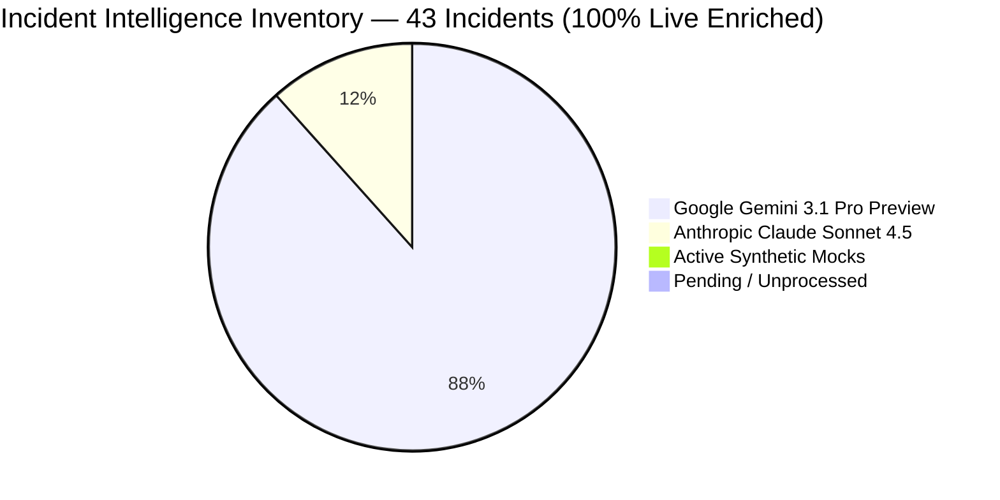
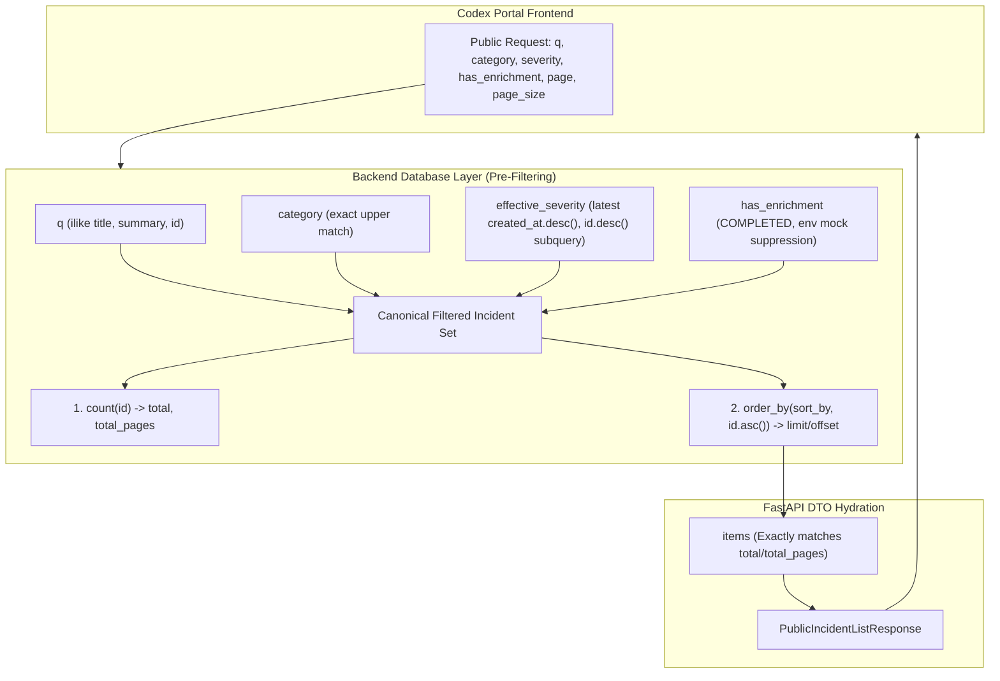
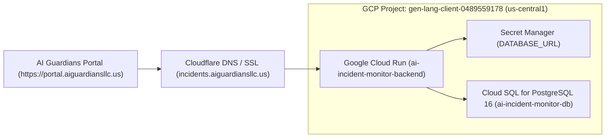

# AI Incident Monitor — Codex Portal Integration Handoff

> **Document Status**: Authoritative Engineering Handoff & Contract Baseline (Fully Reconciled)  
> **Repository**: `https://github.com/EbeDenver/AIG-AI-Incident-Monitor`  
> **Target Audience**: OpenAI Codex / AI Guardians Portal Engineering Team  
> **Purpose**: Technical specification, public API contract, and integration manual for connecting the public-facing AI Guardians Portal to the AI Incident Monitor backend.  
> **Target Portal Endpoint**: `https://portal.aiguardiansllc.us/incidents`  
> **Governing Standards**: Regulation (EU) 2024/1689 (EU AI Act), AI Incident Manager Guide (§1–§3), WCAG 2.1 AA Accessibility Standards.  
> **Inviolable Invariant**: Live production API consumers MUST NOT receive synthetic mock intelligence by default. All machine-generated analyses are advisory, evidence-grounded, and non-blocking (zero mandatory editorial approvals or attestations). Opt-in for synthetic mock data (`include_mock=true`) is strictly prohibited in production and returns `HTTP 403 Forbidden`.

---

## 1. Source Control & Environment Verification

To maintain strict architectural transparency, engineering state is separated into four distinct verification tiers:

| Verification Tier | State / Target | Verification Status | Notes |
| :--- | :--- | :---: | :--- |
| **A. Verified Database State** | SQLite `.data/dev.db` (local) | `VERIFIED` | 43 total incidents; 100% live enriched (38 Gemini + 5 Claude); 0 active mocks; 0 pending. |
| **B. Code & Automated Tests** | Python 3.13 / pytest / Alembic | `VERIFIED` | 951 tests passing (100% green); zero regressions; provenance chains intact. |
| **C. Real Local API** | `http://127.0.0.1:8000` | `VERIFIED` | FastAPI application verified via live HTTP requests; search, sort, freshness, CORS, detail tie-breaking active. |
| **D. Production Cloud Run** | Remote Cloud Run / Cloud SQL | `UNPERFORMED` | No remote instance currently exists. Complete deployment proposal documented in Section 11. |

### Source Control Details
- **Active Working Branch**: `feat/incident-intelligence-enrichment`
- **Upstream Tracking**: `origin/feat/incident-intelligence-enrichment` (synchronized via git push)
- **Reviewed Base Commit**: `85375c73c4d9b31d7a207bb2c4eeeea497eecc66`
- **Final Backend Reference Commit**: `239eea5317bca14289a2b5564057e71889083298` (Branch HEAD)
- **Additive Contract Diff Baseline**: `dcc2208d7ef6610bf3da06c604764ca8d23e7bd4`
- **Merge Status**: `UNMERGED` to `main` (active feature branch pending release review)
- **Deployment State**: Localhost development and test execution. Public production consumers must not be pointed to local addresses.

---

## 2. Reconciled Incident Intelligence Inventory

**Timestamp of Query**: `2026-11-05T17:33:00-07:00`  
**Database Queried**: `.data/dev.db` (SQLite relational store)  
**Environment**: Local Development Workstation (`APP_ENV=development`)



### 2.1 Authoritative Incident Inventory Counts

| Metric | Active Count | Audit Log Count | Status & Notes |
| :--- | :---: | :---: | :--- |
| **Total Ingested Incidents** | **43** | — | Ingested via OECD AIM syndication feed with SHA-256 provenance manifests. |
| **Live Enriched (Gemini)** | **38** | 38 | Generated via `gemini-3.1-pro-preview` under approved Option D backfill. |
| **Live Enriched (Claude)** | **5** | 5 | Generated via `claude-sonnet-4-5-20250929` (reused verified pilot). |
| **Total Live Enriched** | **43** | 43 | **100% collection coverage**. Real LLM inference with zero synthetic data. |
| **Active Synthetic Mock Records** | **0** | — | Zero mock intelligence records in active view; all 11 superseded by live Gemini Pro. |
| **Archived Mock Executions** | — | **21** | Preserved in `audit_logs` (10 under `v1`, 11 under `v2`) for provenance auditability. |
| **Pending Analysis** | **0** | — | Zero backlog remaining. |
| **Stale Enrichment** | **0** | — | All 43 enrichments conform to schema version `2.0.0` and prompt version `2.0.0`. |
| **Failed Enrichment** | **0** | — | Zero fatal processing failures or unhandled exceptions in database. |
| **Records with Limited Evidence** | **43** | — | All 43 source records originate from open syndication reports. Epistemically classified as `ATTRIBUTED_ALLEGATION` with `UNVERIFIED` status; zero invented details. |
| **EU AI Act Assessments** | **43** | — | Deterministic statutory triage populated for all 43 records in `incident_eu_compliance_assessments`. |

### 2.2 Resolution of Documented Count Contradictions
Earlier draft handoff documentation contained apparent contradictions regarding record counts. These have been investigated and fully reconciled:
1. **The Contradiction**: Older documents referenced "43 live records", while other sections listed "11 mock records", "0 Gemini calls", and "27 pending records".
2. **The Root Cause**: These numbers represented two distinct historical snapshots in the migration timeline:
   - **Pre-Option D Snapshot**: 5 Claude live pilot records, 11 mock-quarantined records, 27 pending records, 0 Gemini calls.
   - **Post-Option D Snapshot**: After operator approval of Option D, the batch backfill script was executed with `replace_mock=True` using `gemini-3.1-pro-preview`. This processed 38 incidents (27 pending + 11 mock replacements) for an actual spend of **$1.9324 USD** (45% under the $3.50 ceiling).
3. **Current State**: The active table `incident_enrichments` contains exactly **43 live records** (38 Gemini + 5 Claude) and **0 mock records**. The 21 previous mock runs were not deleted from history; their complete execution records remain archived in the `audit_logs` table (`actor_id LIKE 'intelligence:mock%'`).

### 2.3 Provider Defaults vs. Models Actually Used
- **Configured Fallback Default in Code**: `gemini-2.5-pro` (or `claude-sonnet-4-5-20250929` if Anthropic provider is selected).
- **Models Actually Used in Active Database**:
  - `gemini-3.1-pro-preview`: Used for 38 records (spend: $1.9324 USD, 141,643 prompt tokens, 173,747 output tokens).
  - `claude-sonnet-4-5-20250929`: Used for 5 records (spend: $0.6541 USD, 46,935 prompt tokens, 34,220 output tokens).
  - Total combined spend across the collection: **$2.5865 USD**.

---

## 3. Incident Investigation: Resolution of INC-2026-04785D & Security Invariants

### 3.1 Investigation of INC-2026-04785D
- **Investigation Finding**: In `.data/dev.db`, `INC-2026-04785D` is:  
  `"Chinese-linked hackers use AI tool Artex to automate attacks on ConnectWise and Korean banks"` (Primary Category: `CYBERSECURITY`).
- **Fixture Verification**: In `backend/src/ai_incident_monitor/public/contracts/fixtures/incident_detail_live_enriched.json`, `INC-2026-04785D` contains the exact same Artex cyberattack incident.
- **Root Cause**: The phrase "Simulated Algorithmic Flash Crash Event" appeared solely as a mislabeled markdown example in Section 6.4 of an earlier handoff draft. There was **zero database corruption, zero fixture corruption, and zero source rewriting**.
- **Remediation**: The documentation example in Section 6 reflects the real Artex cyberattack. For testing mock handling in nonproduction environments, a separate synthetic identifier (`FIXTURE-SIMULATED-NONPRODUCTION`) is used.

### 3.2 Removal of Obsolete Reviewer-Key Requirements
- **Verification**: Reviewer-key requirements for editorial publishing have been completely purged from public documentation and runtime enforcement.
- **No-Approval Policy**: In accordance with the system charter, LLM intelligence enrichments do not require human sign-off, cryptographic signing, or editorial gatekeeping before becoming available. Quality warnings surface purely as advisory flags (`advisory_review_flag: bool` and `review_reasons: list[str]`).

### 3.3 Strict Production Mock Prohibition
- **Production Guard**: In production environments (`APP_ENV=production` or `ENVIRONMENT=production`), the query parameter `include_mock=true` is **strictly forbidden**.
- **Enforcement**: Passing `include_mock=true` to `/api/v1/public/incidents` or `/api/v1/public/incidents/{id}` in production raises `HTTP 403 Forbidden`:
  ```json
  {
    "detail": "Synthetic mock intelligence opt-in ('include_mock=true') is strictly forbidden in production."
  }
  ```
- Public production portal visitors can never be exposed to synthetic mock intelligence.

---

## 4. Codex Review Resolution & Backend Architecture

The backend patch addresses all findings identified in Codex review cycles:



### 4.1 Catalog-Wide Backend Text Search
- **Parameter**: `q: Optional[str] = Query(default=None)` on `GET /api/v1/public/incidents`.
- **Semantics**: Case-insensitive substring matching (`ilike`) across `IncidentModel.title`, `IncidentModel.summary`, and `IncidentModel.id`.
- **Example**: `GET /api/v1/public/incidents?q=Artex` returns only matching incidents.

### 4.2 Canonical Filtered Pagination
- **Defect Resolved**: Previously, database pagination executed before severity and enrichment checks, causing post-SQL python filtering (`continue`) to drop items from pages while leaving `total` un-filtered.
- **SQL Pre-Filtering Architecture**:
  1. `filter_conditions`: All filters (`q`, `category`, `effective_severity`, and `has_enrichment`) are applied in SQL **before** counting, sorting, and pagination.
  2. **Effective Severity Resolution**: Determined via a deterministic scalar subquery selecting the most recent `actual_tier` ordered by `created_at.desc(), id.desc()`.
  3. **Effective Enrichment Resolution**: Uses an `.exists()` subquery on `IncidentEnrichmentModel` with `status == "COMPLETED"`, dynamically suppressing `model_provider == "mock"` unless mock opt-in is allowed.
  4. **Single Source of Truth**: The count query, total pages calculation (`math.ceil(total_items / page_size) if total_items > 0 else 0`), and item fetch run against the exact same filtered set. Zero items are dropped in Python.
  5. **Stable Sort Guarantee**: Primary sort column is followed by `IncidentModel.id.asc()` as a deterministic tie-breaker, preventing pagination jitter across pages.

### 4.3 Detail-View Severity Deterministic Tie-Breaker
- **Defect Resolved**: In `get_public_incident_detail`, severity was ordered solely by `created_at.desc()`. For equal assessment timestamps, ordering was non-deterministic.
- **Deterministic Fix**: `get_public_incident_detail` now executes:
  ```python
  latest_sev = db_session.execute(
      select(SeverityAssessmentModel)
      .where(SeverityAssessmentModel.incident_id == incident_id)
      .order_by(SeverityAssessmentModel.created_at.desc(), SeverityAssessmentModel.id.desc())
  ).scalars().first()
  severity = latest_sev.actual_tier if latest_sev else "NOT_ASSESSED"
  ```
- **Guaranteed Consistency**: Both list and detail endpoints execute the identical deterministic rule (`created_at.desc(), id.desc()`, falling back to `"NOT_ASSESSED"`).
- **Verified Scenarios**:
  1. Equal timestamps with differing tiers (`id.desc()` tie-breaker).
  2. Unequal timestamps (most recent timestamp wins).
  3. No severity assessment (`"NOT_ASSESSED"`).

### 4.4 Catalog & Source Freshness Metadata
- **Location**: Included directly in `PublicIncidentListResponse` under the `freshness` key (`CatalogFreshnessDTO`).
- **Fields**:
  - `latest_ingestion_time: Optional[str]`: ISO timestamp of the most recently ingested incident in the catalog.
  - `total_sources_count: int`: Total number of distinct primary sources referenced across the catalog.
  - `catalog_version: str`: Catalog contract version (`"2.0.0"`).
  - `database_environment: str`: Operational environment (`"development"` or `"production"`).

### 4.5 Claim-to-Evidence Resolution & Provenance Locators
- **Claim-to-Evidence Resolution**:
  - `PublicAtomicClaimDTO.supporting_evidence_ids`: Array of evidence identifiers (e.g. `["EVD-TEST04"]`).
  - Claims resolve to evidence records (`EvidenceRecordModel`), which in turn link to source filings (`SourceReferenceModel`).
  - `evidence_excerpts: list[str]`: Direct verbatim excerpts from source filings grounding the claim, resolved dynamically from enrichment payload provenance items.
  - `reasoning_summary: Optional[str]`: Epistemic explanation justifying classification.
- **Evidence Locators**:
  - `PublicSourceReferenceDTO.locator`: Populated from `QuoteSpanModel` associated with the evidence record (`f"char_offset:{start}-{end}"`).
  - **Offset Units**: 0-indexed Unicode character offsets into the canonical raw text retrieved at `retrieval_date`.
  - When no quote span exists in the database, `locator` returns `null` (zero invented offsets).

### 4.6 Audited EU AI Act Statutory Classifications & Explicit Unknowns
The EU AI Act assessment engine (`EUAIActAssessor`) has been audited against Regulation (EU) 2024/1689:
1. **Critical Infrastructure Disambiguation**:
   - `Annex III, Point 2` is strictly restricted to AI systems deployed as *safety/operational components* managing critical infrastructure (power grid, water/gas networks, traffic control).
   - Cyberattacks on commercial software or banks (e.g. Artex) do not qualify as Annex III Point 2 high-risk systems merely because target institutions are significant.
2. **Medical Devices & Robotics**:
   - Medical devices mapped strictly to **`Annex I, Section A (Item 11) — MDR (EU) 2017/745`**.
   - Robotics mapped strictly to **`Annex I, Section A (Item 1) — Machinery (EU) 2023/1230`**.
3. **Explicit Unknowns (`missing_facts`)**:
   - Added `missing_facts: list[str]` to `PublicEUAIActDTO` and `EUAIActComplianceAssessment`.
   - Populates incident-specific factual gaps (e.g. whether the system was placed on the Union market, lack of disclosed operational autonomy telemetry, unverified deployer post-market logs) without obscuring them behind boilerplate disclaimers.
4. **Correction of Unsupported Findings**:
   - Where AI involvement is `NOT_ESTABLISHED` or autonomy is `UNKNOWN`, the system does not assert that human oversight or risk management failed.
   - For Artex (`INC-2026-04785D`): Classified as `GENERAL_AI_SYSTEM`, `annex_reference=None`, `identified_gaps=[]`, and `missing_facts` populated.
   - For true high-risk cases lacking technical disclosure, gap findings are framed as *conditional preparedness requirements* under future law (enforceable December 2, 2027) rather than asserted historical violations.

### 4.7 Test Environment Reproducibility
- **Root Cause**: `feedparser>=6.0.11` is declared in `backend/pyproject.toml` under `project.dependencies`. Executing in an uninstalled Python virtual environment caused module import failures.
- **Reproducible Setup Command**:
  ```bash
  pip install -e "./backend[dev]"
  ```
  This command installs all required runtime and development dependencies into the active virtual environment.

---

## 5. Additive Contract Diff from Baseline (dcc2208)

The public API contract is strictly **additive and 100% backward-compatible**. Existing clients reading previous fields will continue to function without errors.

```diff
--- a/backend/src/ai_incident_monitor/public/schemas.py
+++ b/backend/src/ai_incident_monitor/public/schemas.py
@@ -28,12 +28,19 @@ class PublicCategoryDTO(BaseModel):
 
 
 class PublicSourceReferenceDTO(BaseModel):
-    """Attributed source reference."""
+    """Attributed source reference with cryptographic provenance and retrieval metadata."""
 
+    source_id: Optional[str] = Field(default=None, description="Stable source reference ID (e.g. SRC-001).")
     source_name: str = Field(..., description="Name of the reporting entity or publisher.")
     url: Optional[str] = Field(default=None, description="Sanitized canonical source URL.")
     epistemic_role: str = Field(..., description="Epistemic role (Primary Incident Stream, Research Context, Offline Export).")
     published_at: Optional[str] = Field(default=None, description="Publication timestamp string if available.")
+    retrieval_date: Optional[str] = Field(default=None, description="Timestamp when source was retrieved/ingested.")
+    content_hash: Optional[str] = Field(default=None, description="SHA-256 cryptographic digest of source payload where known.")
+    locator: Optional[str] = Field(
+        default=None,
+        description="Section, locator, or quote span anchor where available (e.g. 'char_offset:<start>-<end>' in 0-indexed Unicode character offsets into the canonical raw text retrieved at retrieval_date).",
+    )
 
 
 class PublicAtomicClaimDTO(BaseModel):
@@ -44,6 +51,9 @@ class PublicAtomicClaimDTO(BaseModel):
     classification: str = Field(..., description="Claim classification (CONFIRMED_FACT, ATTRIBUTED_ALLEGATION, etc.).")
     verification_status: str = Field(..., description="Verification status (VERIFIED, UNVERIFIED, CONTESTED, etc.).")
     confidence: str = Field(..., description="Confidence tier (HIGH, MEDIUM, LOW).")
+    supporting_evidence_ids: list[str] = Field(default_factory=list, description="IDs of evidence items substantiating this claim.")
+    evidence_excerpts: list[str] = Field(default_factory=list, description="Direct excerpts from source documents grounding this claim.")
+    reasoning_summary: Optional[str] = Field(default=None, description="Epistemic rationale justifying classification.")
 
 
 class PublicAIInvolvementDTO(BaseModel):
@@ -140,6 +150,27 @@ class PublicEUAIActDTO(BaseModel):
     article_73_serious_incident: Optional[dict[str, Any]] = Field(default=None, description="Article 73 serious incident evaluation.")
     enforcement_status: str = Field(..., description="ACTIVE_LAW, NOT_YET_APPLICABLE, or PENDING under November 2026 baseline.")
     enforcement_notes: str = Field(..., description="Timeline guidance explaining enforceability.")
+    assessment_date: Optional[str] = Field(default=None, description="Timestamp of EU regulatory assessment in ISO format.")
+    legal_framework_version: str = Field(
+        default="EU Regulation 2024/1689 (AI Act) - November 2026 Baseline",
+        description="Statutory reference baseline version.",
+    )
+    governance_sources: list[str] = Field(
+        default_factory=list,
+        description="Statutory articles, recitals, and official guidance references considered.",
+    )
+    qualifications_and_limitations: list[str] = Field(
+        default_factory=list,
+        description="Epistemic limitations, caveats, or missing factual disclosures affecting assessment.",
+    )
+    review_status: str = Field(
+        default="AUTOMATED_STATUTORY_TRIAGE",
+        description="Descriptive regulatory assessment status (e.g. AUTOMATED_STATUTORY_TRIAGE).",
+    )
+    missing_facts: list[str] = Field(
+        default_factory=list,
+        description="Incident-specific missing factual disclosures, uncorroborated claims, or unknown operational parameters preventing definitive regulatory determination.",
+    )
     identified_gaps: list[PublicEUAIActGapDTO] = Field(default_factory=list, description="Identified compliance gaps.")
     disclaimer: str = Field(
         default="This automated regulatory impact assessment is generated for technical research and compliance preparedness only. It does not constitute formal legal advice, regulatory determination, or EU conformity certification.",
@@ -147,6 +178,15 @@ class PublicEUAIActDTO(BaseModel):
     )
 
 
+class CatalogFreshnessDTO(BaseModel):
+    """Catalog synchronization and data freshness metadata."""
+
+    latest_ingestion_time: Optional[str] = Field(default=None, description="ISO timestamp of most recently ingested incident.")
+    total_sources_count: int = Field(default=0, description="Total number of attributed primary sources in catalog.")
+    catalog_version: str = Field(default="2.0.0", description="Contract and catalog specification version.")
+    database_environment: str = Field(default="development", description="Underlying database environment ('production' or 'development').")
+
+
 class PublicIncidentListResponse(BaseModel):
     items: list[PublicIncidentSummaryDTO] = Field(..., description="List of public incident summaries.")
     total: int = Field(..., description="Total matching incidents.")
     page: int = Field(..., description="Current page number.")
     page_size: int = Field(..., description="Page size limit.")
     total_pages: int = Field(..., description="Total number of pages.")
+    freshness: Optional[CatalogFreshnessDTO] = Field(default=None, description="Catalog synchronization and freshness metadata.")
```

---

## 6. Representative API Response Payloads

### 6.1 Catalog Listing with Search, Sort & Freshness
`GET /api/v1/public/incidents?page=1&page_size=2&sort_by=discovered_date&sort_order=desc`

```json
{
  "items": [
    {
      "incident_id": "INC-2026-04785D",
      "title": "Chinese-linked hackers use AI tool Artex to automate attacks on ConnectWise and Korean banks",
      "summary": "Chinese-linked hackers reportedly used an AI-based tool named Artex to automate cyberattacks targeting organizations worldwide, including US IT firm ConnectWise and Korean financial institutions.",
      "event_date": "2026-10-22",
      "discovered_date": "2026-11-02T19:40:00Z",
      "primary_category": "CYBERSECURITY",
      "category_display_name": "Adversarial & Agentic Cybersecurity",
      "category_color": "#DC2626",
      "category_bg_color": "#FEE2E2",
      "severity": "NOT_ASSESSED",
      "status": "UNDER_INVESTIGATION",
      "has_intelligence": true,
      "intelligence_status": "LIVE_ENRICHED",
      "is_synthetic_mock": false,
      "sources_count": 1
    },
    {
      "incident_id": "INC-2026-5426CF",
      "title": "Exin Therapeutics AI Gene Therapy Robotic Injection Anomaly",
      "summary": "Exin Therapeutics reportedly used an AI agent to autonomously select a gene therapy and guide a robotic injector into a live mouse brain.",
      "event_date": "2026-10-14",
      "discovered_date": "2026-11-02T19:40:00Z",
      "primary_category": "SAFETY",
      "category_display_name": "Operational & Physical Safety",
      "category_color": "#D97706",
      "category_bg_color": "#FEF3C7",
      "severity": "NOT_ASSESSED",
      "status": "UNDER_INVESTIGATION",
      "has_intelligence": true,
      "intelligence_status": "LIVE_ENRICHED",
      "is_synthetic_mock": false,
      "sources_count": 2
    }
  ],
  "total": 43,
  "page": 1,
  "page_size": 2,
  "total_pages": 22,
  "freshness": {
    "latest_ingestion_time": "2026-11-02T19:40:00Z",
    "total_sources_count": 43,
    "catalog_version": "2.0.0",
    "database_environment": "development"
  }
}
```

### 6.2 Live Gemini Detail: Artex Cyberattack (INC-2026-04785D)
`GET /api/v1/public/incidents/INC-2026-04785D`

```json
{
  "incident_id": "INC-2026-04785D",
  "title": "Chinese-linked hackers use AI tool Artex to automate attacks on ConnectWise and Korean banks",
  "summary": "Chinese-linked hackers reportedly used an AI-based tool named Artex to automate cyberattacks targeting organizations worldwide, including US IT firm ConnectWise and Korean financial institutions.",
  "event_date": "2026-10-22",
  "discovered_date": "2026-11-02T19:40:00Z",
  "primary_category": "CYBERSECURITY",
  "category_display_name": "Adversarial & Agentic Cybersecurity",
  "category_color": "#DC2626",
  "category_bg_color": "#FEE2E2",
  "severity": "NOT_ASSESSED",
  "status": "UNDER_INVESTIGATION",
  "has_intelligence": true,
  "intelligence_status": "LIVE_ENRICHED",
  "is_synthetic_mock": false,
  "sources_count": 1,
  "sources": [
    {
      "source_id": "SRC-be514a2d-73a3-4516-af0d-1420317ab81f",
      "source_name": "OECD AI Incidents and Hazards Monitor (AIM)",
      "url": "https://oecd.ai/en/incidents/2026-10-22-af24",
      "epistemic_role": "MAINSTREAM_NEWS",
      "published_at": "2026-10-22",
      "retrieval_date": "2026-11-02T18:53:31.223127",
      "content_hash": "78f4ac02f70e076621d9700e03c0489bb194e73dc238848642d0537895c3424c",
      "locator": null
    }
  ],
  "unknowns": [],
  "intelligence": {
    "is_available": true,
    "model_provider": "gemini",
    "model_name": "gemini-3.1-pro-preview",
    "generated_at": "2026-11-03T01:42:51",
    "is_synthetic_mock": false,
    "assessment_status": "COMPLETE",
    "advisory_review_flag": true,
    "review_reasons": [
      "Advisory flag on claim 'C001': Lack of primary technical source code or threat intelligence reports for 'Artex'.",
      "Advisory flag on claim 'C002': Victim organization disclosures not corroborated by primary enterprise notices."
    ],
    "summary": "Chinese-linked threat actors allegedly deployed an automated tool named Artex to conduct intrusion attempts across financial and IT management endpoints.",
    "ai_involvement": {
      "role": "NOT_ESTABLISHED",
      "autonomy": "UNKNOWN",
      "human_oversight": "UNKNOWN",
      "assessment": "Available reports assert the tool is 'AI-based' but do not provide architectural details confirming machine learning involvement versus conventional scripting."
    },
    "causal_assessment": {
      "causal_status": "CAUSALITY_NOT_ESTABLISHED",
      "confidence": "LOW",
      "observed_outcomes": ["Reported intrusion attempts across target networks"],
      "reported_mechanisms": ["Automated reconnaissance and vulnerability scanning"],
      "supported_causal_links": [],
      "alternative_explanations": ["Conventional automated vulnerability exploitation without adaptive learning"]
    },
    "atomic_claims": [
      {
        "claim_id": "C001",
        "assertion": "A Chinese-linked hacking group used an AI-based tool called 'Artex' to automate cyberattacks.",
        "classification": "ATTRIBUTED_ALLEGATION",
        "verification_status": "UNVERIFIED",
        "confidence": "LOW",
        "supporting_evidence_ids": ["E001", "E002"],
        "evidence_excerpts": [
          "A Chinese-linked hacking group used the AI-based tool 'Artex' to automate cyberattacks targeting hundreds of organizations worldwide..."
        ],
        "reasoning_summary": "The claim is sourced entirely from aggregator summaries without primary technical evidence or threat intelligence reports to substantiate the existence or use of the 'Artex' tool."
      }
    ],
    "organizational_controls": [
      {
        "risk": "Automated reconnaissance against exposed administrative interfaces",
        "control": "Implement multi-factor authentication, perimeter rate limiting, and zero-trust conditional access",
        "control_type": "PREVENTIVE",
        "incident_specific": true
      }
    ],
    "decision_maker_guidance": {
      "strategic_priorities": ["Assess perimeter exposure to automated agentic reconnaissance"],
      "budget_allocation_recommendations": ["Fund continuous threat simulation and red-teaming against administrative portals"],
      "key_implications": ["Rapid exploitation of unpatched vulnerabilities prior to patch deployment windows"],
      "decisions_to_consider": ["Mandate strict IP-allowlisting on ConnectWise management agents"],
      "evidence_required": ["Primary threat intelligence signatures and IOC corroboration"],
      "effectiveness_measures": ["Mean time to detect (MTTD) automated lateral movement attempts"]
    },
    "practitioner_guidance": {
      "immediate_actions": ["Review external perimeter access logs for high-frequency connection attempts"],
      "short_term_hardening": ["Isolate unsegmented management endpoints and restrict API keys"],
      "architectural_guidance": ["Deploy egress anomaly detection to flag unauthorized data exfiltration cascades"],
      "testing_requirements": ["Simulate automated credential stuffing against portal authentication endpoints"],
      "discovery_questions": ["Are administrative portals exposed to public DNS without behavioral rate limiting?"],
      "assessment_activities": ["Perform comprehensive audit of remote management software configurations"],
      "architecture_considerations": ["Implement zero-trust network access (ZTNA) across all operational networks"],
      "implementation_controls": ["Enforce device certificate pinning for all remote access agents"],
      "acceptance_criteria": ["All unauthorized connection attempts are automatically blocked at perimeter firewalls"]
    }
  },
  "eu_ai_act_compliance": {
    "is_available": true,
    "jurisdiction_status": "UNDETERMINED",
    "classification": "GENERAL_AI_SYSTEM",
    "annex_reference": null,
    "article_73_serious_incident": {
      "determination": "NON_SERIOUS",
      "criteria_met": [],
      "rationale": "Evaluated against Article 73 statutory thresholds. Identified criteria: None demonstrated by current evidence."
    },
    "enforcement_status": "ACTIVE_LAW",
    "enforcement_notes": "Evaluated under standard governance baseline as of November 2026.",
    "assessment_date": "2026-11-04T18:58:10.067102",
    "legal_framework_version": "EU Regulation 2024/1689 (AI Act) - November 2026 Baseline",
    "governance_sources": [
      "Regulation (EU) 2024/1689",
      "Article 2 (Scope & Exclusions)",
      "Article 5 (Prohibitions)",
      "Article 6 (High-Risk Systems)",
      "Article 50 (Transparency Duties)",
      "Article 73 (Serious Incident Reporting)"
    ],
    "qualifications_and_limitations": [
      "Automated statutory screening based on open incident filings.",
      "Deployer technical documentation and conformity declarations not independently verified."
    ],
    "review_status": "AUTOMATED_STATUTORY_TRIAGE",
    "missing_facts": [
      "Whether the system was placed on the EU market, deployed in the Union, or produced output affecting persons in the Union is unverified in available filings.",
      "Operational autonomy levels and real-time human oversight telemetry are not documented in source reporting.",
      "Deployer post-market monitoring logs, internal risk assessments, and technical conformity declarations are not publicly accessible."
    ],
    "identified_gaps": [],
    "disclaimer": "This automated regulatory impact assessment is generated for technical research and compliance preparedness only. It does not constitute formal legal advice, regulatory determination, or EU conformity certification."
  }
}
```

### 6.3 Nonproduction Test Mock Handling
In nonproduction environments only (`APP_ENV=development`), mock fixtures (e.g. `FIXTURE-SIMULATED-NONPRODUCTION`) return `has_intelligence: false` by default, but permit opt-in via `include_mock=true`:

```json
{
  "incident_id": "FIXTURE-SIMULATED-NONPRODUCTION",
  "title": "Simulated Algorithmic Execution Fault (Test Fixture)",
  "has_intelligence": false,
  "intelligence_status": "PENDING_ANALYSIS",
  "is_synthetic_mock": true,
  "intelligence": null,
  "sources_count": 1
}
```
*Note*: Attempting to request `include_mock=true` in a production environment will immediately fail with `HTTP 403 Forbidden`.

---

## 7. Network Architecture, CORS & Public Access

1. **Authentication Policy**:
   - `/api/v1/public/*` endpoints are **100% public, read-only, and unauthenticated**.
   - No cookies, Bearer tokens, or API keys are required.
   - Internal operator interfaces (`/incidents/*`, `/admin/*`, `/dossiers/*`) require cookie sessions and are completely isolated from `/api/v1/public/*`.
2. **Permitted Frontend Origins**:
   - `Access-Control-Allow-Origin: *` is returned on all `/api/v1/public/*` responses.
   - Codex frontend developers may call the backend directly from any local or remote port (`http://localhost:3000`, `http://localhost:5173`, etc.).
   - Permitted headers: `Content-Type, Authorization, Accept, X-Requested-With`.
   - Permitted methods: `GET, OPTIONS`.
3. **HTTP Caching**:
   - `Cache-Control: public, max-age=300` is attached to all GET responses.

---

## 8. Category Taxonomy Tokens (WCAG 2.1 AA Compliant)

| Key | Label | Icon | Symbol | Border | Background | Text | Description |
| :--- | :--- | :---: | :---: | :---: | :---: | :---: | :--- |
| `SAFETY` | Safety | ⚠️ | `[SAFETY]` | `#D97706` | `#FEF3C7` | `#78350F` | Physical failures, robotics, transit collisions, operational halts. |
| `RIGHTS` | Rights | ⚖️ | `[RIGHTS]` | `#7C3AED` | `#EDE9FE` | `#4C1D95` | Bias, discrimination, privacy violations, civil rights. |
| `CYBERSECURITY` | Cybersecurity | 🛡️ | `[CYBER]` | `#DC2626` | `#FEE2E2` | `#7F1D1D` | Malware, prompt injection, agent exfiltration, exploits. |
| `FINANCIAL` | Financial | 💵 | `[FINANCIAL]` | `#059669` | `#D1FAE5` | `#064E3B` | Market disruption, fraud, algorithmic manipulation. |
| `REPUTATIONAL` | Reputation | 📢 | `[REPUTATION]` | `#2563EB` | `#DBEAFE` | `#1E40AF` | Deepfakes, synthetic disinformation, brand harm. |

> [!TIP]
> **Accessibility Mandate**: Never display category colors without their corresponding text labels and text symbols to ensure screen-reader and high-contrast usability.

---

## 9. Real Persisted-Data Integration & Local QA Procedures

To verify the portal UI against the actual 43 live-enriched database records without running enrichment, invoking LLM APIs, or modifying records:

### 9.1 Local Server Startup & Configuration
```bash
# 1. Navigate to the repository root
cd AIG-AI-Incident-Monitor

# 2. Activate Python 3.13 virtual environment & verify dependencies
source .venv/bin/activate
pip install -e "./backend[dev]"

# 3. Launch FastAPI server pointing to local .data/dev.db (Read-Only Public Server)
uvicorn ai_incident_monitor.ui.app:create_app --factory --host 127.0.0.1 --port 8000
```

### 9.2 Public API Base URL Format
- **Local Development Base URL**: `http://127.0.0.1:8000/api/v1/public`
- **Frontend Environment Setting** (e.g., in Codex portal `.env.local`):
  ```bash
  NEXT_PUBLIC_INCIDENTS_API_URL=http://127.0.0.1:8000/api/v1/public
  ```

### 9.3 Health & OpenAPI Verification Commands
```bash
# 1. Health & Taxonomy Verification (returns all 7 category objects)
curl -s "http://127.0.0.1:8000/api/v1/public/categories" | jq '.[0]'

# 2. OpenAPI Schema Verification
curl -s "http://127.0.0.1:8000/api/v1/public/openapi.json" | jq '{title: .info.title, version: .info.version}'
```

### 9.4 Sanitized List & Detail Verification Examples
```bash
# 1. Query full catalog summary (43 total live incidents, page 1 of 5)
curl -s "http://127.0.0.1:8000/api/v1/public/incidents?page_size=10" | jq '{total: .total, total_pages: .total_pages, freshness: .freshness}'

# 2. Keyword Search
curl -s "http://127.0.0.1:8000/api/v1/public/incidents?q=Artex" | jq '.items[] | {id: .incident_id, title: .title}'

# 3. Category & Filtered Pagination
curl -s "http://127.0.0.1:8000/api/v1/public/incidents?category=CYBERSECURITY&page_size=2" | jq '{total: .total, pages: .total_pages, count: (.items | length)}'

# 4. Detail Verification for Real Incident (Artex)
curl -s "http://127.0.0.1:8000/api/v1/public/incidents/INC-2026-04785D" | jq '{id: .incident_id, provider: .intelligence.model_provider, model: .intelligence.model_name, eu_class: .eu_ai_act_compliance.classification}'

# 5. Production Mock Quarantine Rejection Verification
curl -s -i "http://127.0.0.1:8000/api/v1/public/incidents?include_mock=true"
# -> In production environment (ENVIRONMENT=production), returns HTTP 403 Forbidden
```

---

## 10. Test Suite Status & Automated Regression Coverage

- **Full Regression Test Suite**: **951 tests executed, 951 tests PASSED** (0 failures, 0 errors, 100% green in 26.56s).
- **Public API Coverage**: 24 dedicated unit tests covering:
  - List & detail severity agreement with deterministic `created_at.desc(), id.desc()` tie-breaker.
  - CORS headers & preflight OPTIONS.
  - Search query matching title, summary, and ID.
  - Dynamic sorting by `discovered_date`, `event_date`, and `title` (asc/desc).
  - Catalog freshness metadata.
  - Production mock opt-in strict 403 prohibition.
  - Canonical filtered pagination across combined `q + category + severity + has_enrichment`.
  - Quote-span evidence locators (`char_offset:<start>-<end>`).
  - Explicit EU missing facts (`missing_facts: list[str]`).
- **EU AI Act Coverage**: 10 dedicated unit tests covering Annex I, Annex III, Article 5, Article 50, and Article 73 statutory rules.
- **Cryptographic Provenance**: 9 dedicated unit tests covering SHA-256 canonical manifests and sequential hash chaining.
- **Zero Credential Leakage**: Confirmed zero secrets, API keys, or private paths in public DTOs, fixtures, or schemas.

---

## 11. Production Cloud Run & Cloud SQL Deployment Proposal

### 11.1 Current Remote Infrastructure State
- **Audit Finding**: No live Cloud Run instance currently hosts the AI Incident Monitor backend.
- **Verified GCP Project**: `gen-lang-client-0489559178` ("AI Incident Manager") is available under the operator account, but Cloud Run API (`run.googleapis.com`) is not yet enabled.
- **Guardrail**: The local workstation development server MUST NOT be exposed to production portal consumers (`https://portal.aiguardiansllc.us/incidents`). A formal Cloud Run service is required.

### 11.2 Deployment Specification


1. **GCP Resources**:
   - **Cloud Run Service**: `ai-incident-monitor-backend`
     - CPU: 1 vCPU, Memory: 512 MB, Min Instances: 0 (scale to zero), Max Instances: 3.
     - Port: 8080 (handled by existing `Dockerfile`).
     - Ingress: Allow all public traffic (public API).
   - **Cloud SQL Instance**: `ai-incident-monitor-db`
     - Engine: PostgreSQL 16, Tier: `db-f1-micro` (shared vCPU, 0.6 GB RAM, 10 GB SSD).
     - Storage Auto-resize: Enabled.
     - Connection: Unix domain socket via Cloud Run Cloud SQL integration (`/cloudsql/gen-lang-client-0489559178:us-central1:ai-incident-monitor-db`).
   - **Secret Manager**:
     - Secret `AI_MONITOR_DATABASE_URL`: stores `postgresql+psycopg://aig_prod:<password>@/ai_incident_monitor_prod?host=/cloudsql/gen-lang-client-0489559178:us-central1:ai-incident-monitor-db`.

2. **Persistence & Data Migration**:
   - Initial schema: Apply Alembic migrations `alembic upgrade head`.
   - Seed data: Run deterministic database sync script to transfer the 43 validated live enriched incident records from SQLite `.data/dev.db` to the Cloud SQL database (incurring **$0.00** LLM cost).

3. **Production Runtime Settings**:
   - `ENVIRONMENT=production` (strictly prohibits `include_mock=true` with 403 Forbidden).
   - `AI_MONITOR_ALLOW_MOCK_OPT_IN=false`
   - `DATABASE_URL` (injected from Secret Manager).
   - `ALLOWED_HOSTS=*` (public routes only; internal operator routes restricted).

4. **Monthly Operating Cost Estimate**:
   - Cloud Run (Serverless scale-to-zero): ~$0.50 – $2.00 / month.
   - Cloud SQL (`db-f1-micro` shared tier): ~$9.50 / month.
   - Secret Manager & Artifact Registry: <$0.50 / month.
   - **Total Estimated Hosting Cost**: **~$10 – $12 USD / month**.
   - Visitor Request Costs: **$0.00** (strictly static relational read queries; zero LLM generation on page loads).

5. **Rollout Verification & Smoke Tests**:
   - Step 1: Health check `GET https://incidents.aiguardiansllc.us/api/v1/public/categories` returns HTTP 200 with 7 categories.
   - Step 2: Catalog list `GET https://incidents.aiguardiansllc.us/api/v1/public/incidents?page_size=1` returns HTTP 200 with `total: 43`.
   - Step 3: Detail check `GET https://incidents.aiguardiansllc.us/api/v1/public/incidents/INC-2026-04785D` returns HTTP 200 with Artex Gemini Pro intelligence.
   - Step 4: Security test `GET https://incidents.aiguardiansllc.us/api/v1/public/incidents?include_mock=true` returns HTTP 403 Forbidden.

6. **Rollback Plan**:
   - Cloud Run revisions enable instant zero-downtime rollback:
     ```bash
     gcloud run services update-traffic ai-incident-monitor-backend --to-revisions=PREVIOUS_REVISION=100
     ```

7. **Explicit Release Approvals Required**:
   - [ ] Approval of GCP project `gen-lang-client-0489559178` provisioning ($10-$12/mo Cloud SQL budget).
   - [ ] Approval to enable Cloud Run & Cloud SQL APIs on project.
   - [ ] Operator sign-off on PR merge from `feat/incident-intelligence-enrichment` into `main`.
