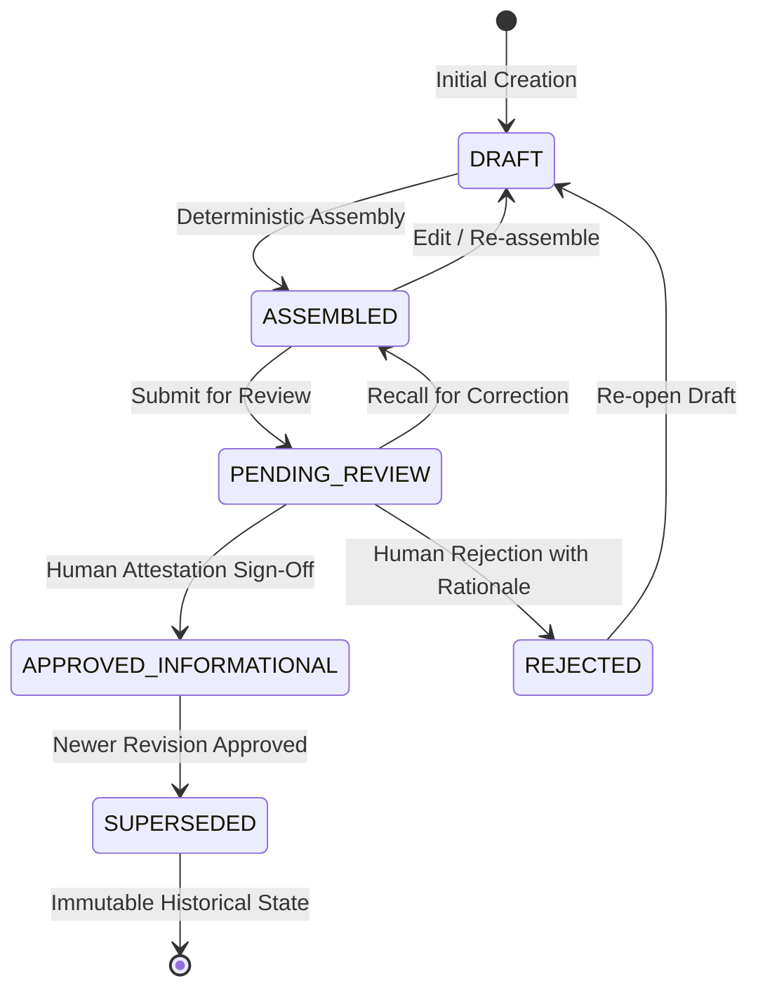

# Editorial Workflow & Dossier Review Methodology

**Document Identifier:** METH-004  
**Project:** AI Incident Monitor  
**Organization:** AI Guardians LLC  
**Milestone:** Phase 6 (Phase 6A & Phase 6B Implemented)  
**Effective Date:** 2026-10-24  
**Status:** APPROVED & IMPLEMENTED  

---

## 1. Executive Summary & Authoritative Product Workflow

The AI Incident Monitor editorial pipeline transforms automated observational intelligence into publication-ready research dossiers under strict human editorial oversight.

The end-to-end operational pipeline operates under the following **authoritative workflow**:

```
Automatic Ingestion
      ↓
Automatic Internal Processing (Deduplication, Scoring, Linkage)
      ↓
Automatic Dossier Preparation & Assembly
      ↓
Deterministic Rendering & Local Working Draft Export (Internal Review Copy)
      ↓
Human Editorial Review & Attestation (Single Human-in-the-Loop Checkpoint)
      ↓
Deterministic Rendering & Local Final Draft Export (Approved Editorial Copy)
      ↓
Manual Publication by Operator (External to System / Substack)
```

### Key Epistemic Principles:
1. **Zero Per-Incident Approval Barrier for Ingestion & Selection:** The system ingests, stores, deduplicates, assesses, and selects public reporting without individual human sign-off. Ordinary attributed reporting enters draft dossiers automatically based on verifiable data integrity (presence of $\ge 1$ evidence link and clean payloads), not human pre-approval.
2. **Dossier as Primary Review Checkpoint:** Human editorial review is **not** performed on every ingested incident record. The assembled editorial dossier is the primary human-review checkpoint. One dossier-level approval covers all entries within the exact reviewed version.
3. **Optional EU & Governance Commentary Barrier:** Ordinary incident reporting is decoupled from regulatory determinations. If optional EU AI Act commentary is requested, it must strictly satisfy Phase 5 controls (`APPROVED_INFORMATIONAL` status, validated disclaimer, zero linter findings). If unapproved or missing, EU commentary is **cleanly omitted** with an internal rationale without blocking the incident's ordinary factual reporting.
4. **Manual Publication Only:** No automated publication, external distribution, Substack API connection, email dispatch, or social posting is implemented or permitted. The operator manually publishes the final dossier.
5. **Phase Boundaries:** Phase 6A established the domain models, relational persistence (Migration 006), assembly engine, validator, review state machine, and local CLI. Phase 6B implements deterministic rendering (Markdown and JSON package), cryptographic export manifests, safe local file export, and the `export-dossier` CLI command. External distribution remains strictly out of scope.

---

## 2. Dossier Lifecycle & State Machine

Editorial dossiers transition through an explicit, non-bypassable state machine enforcing human primacy (Constitutional Rules 12, 14, 15):



### State Definitions:
- `DRAFT`: Initial unvalidated working draft or re-opened record.
- `ASSEMBLED`: Programmatically generated from eligible candidate incidents; canonical content and preliminary SHA-256 content hash locked.
- `PENDING_REVIEW`: Submitted to the review queue; awaits authenticated human evaluation.
- `APPROVED_INFORMATIONAL`: Formally reviewed and attested by an authenticated human reviewer. Content is strictly immutable.
- `REJECTED`: Declined by a human reviewer with a non-empty, mandatory rationale preserved in history.
- `SUPERSEDED`: Prior approved version retired and replaced by a newer approved dossier revision.

---

## 3. Human Reviewer Attestation & Cryptographic Binding

Constitutional Rules 12 and 14 strictly forbid automated algorithms, LLMs, or autonomous agents from self-approving or self-attesting.

Approval requires an authenticated human reviewer submitting an immutable attestation:

```json
{
  "reviewer_id": "human_editor_lead",
  "reviewer_name": "Jane Doe",
  "reviewer_role": "Lead Editorial Analyst",
  "is_human": true,
  "statement_confirmed": true,
  "attestation_statement": "I confirm that I have conducted human editorial review of this dossier, verifying source attribution, factual hedging, distinction between established facts and unverified allegations, and strict non-legal language compliance in accordance with AI Guardians editorial standards.",
  "content_hash": "e3b0c44298fc1c149afbf4c8996fb92427ae41e4649b934ca495991b7852b855",
  "dossier_id": "dos_2026_w10",
  "dossier_version": 1,
  "attested_at": "2026-10-23T20:00:00Z"
}
```

### Five Approval Gates (Fail-Closed):
1. **Review Status:** Dossier must be in `PENDING_REVIEW`.
2. **Human Identity:** Reviewer must have `is_human=True` and non-empty `reviewer_id`.
3. **Confirmed Attestation:** Statement must be explicitly confirmed (`statement_confirmed=True`).
4. **Content Hash Lock:** The attestation's `content_hash` must match the recomputed canonical content hash of the dossier.
5. **Zero Blocking Validation Findings:** `EditorialValidator` must report `is_valid=True` and `blocking_count=0`.
6. **Zero Source Drift:** Current underlying source/incident records must match the `source_version_hash` recorded at assembly.

---

## 4. Deterministic Assembly Engine & Epistemic Boundaries

Dossier assembly is 100% programmatic and reproducible. **Zero LLM or generative inference is utilized.**

### Invariants:
1. **Deterministic Ordering:** Entries are sorted primarily by severity score descending, secondary by incident ID ascending.
2. **Epistemic Tri-State Separation (Rule 2):**
   - **Established Facts:** Grounded in primary observation or corporate admissions.
   - **Allegations:** Grounded in lawsuits, investigative journalism, or whistleblower accounts; must be explicitly attributed (`attribution="Reported assertion (ALLEGATION)"`). Never converted into proven facts.
   - **Unknowns:** Documented questions and missing variables; never coerced to zero.
   - **Disputes:** Contested claims preserved with competing positions and evidence IDs.
3. **Culpability & Causation Shield (Rule 11):** The engine never infers statutory violations, legal liability, or unadjudicated guilt.
4. **Mandatory Disclaimer (Rule 10):**
   - Version: `editorial-v1`
   - Exact text:
     > "Informational research dossier only. This document is compiled from recorded public reporting and observational evidence for technical research and monitoring purposes. It does not constitute legal advice, a formal regulatory finding, an adjudication of culpability, or a definitive determination of statutory compliance or noncompliance. Unverified allegations remain attributed to their respective sources and should not be construed as established facts."

---

## 5. Append-Only Cryptographic Audit Log & Supersession

All lifecycle events write directly to the `governance_audit_logs` relational table with SHA-256 sequential chaining:
- `CREATE_DOSSIER`
- `ASSEMBLE_DOSSIER`
- `VALIDATE_DOSSIER`
- `SUBMIT_FOR_REVIEW`
- `APPROVE_DOSSIER`
- `REJECT_DOSSIER`
- `SUPERSEDE_DOSSIER`
- `EXPORT_DOSSIER`

Each event records `before_state_digest`, `after_state_digest`, `previous_event_hash`, and a computed `event_hash`. Tampering or reordering of audit events is immediately detected by `EditorialRepository.verify_audit_chain()`.

---

## 6. CLI Operational Commands

The non-interactive CLI (`python -m ai_incident_monitor.editorial.cli`) provides comprehensive operational support:

| Command | Purpose | Output Modes |
| :--- | :--- | :--- |
| `select-candidates` | Evaluate candidate incidents from repository | Formatted text / `--json` |
| `assemble-dossier` | Deterministically assemble candidate incidents | Formatted text / `--json` / `--dry-run` |
| `inspect-dossier` | Display structured dossier contents and entries | Formatted text / `--json` |
| `validate-dossier` | Run forensic safety checks; exit code 0=pass, 2=fail | Formatted text / `--json` |
| `submit-for-review` | Submit assembled draft to review queue | Formatted text / `--json` / `--dry-run` |
| `approve-dossier` | Human sign-off with attestation; exit code 0=pass | Formatted text / `--json` / `--dry-run` |
| `reject-dossier` | Decline draft with mandatory documented rationale | Formatted text / `--json` / `--dry-run` |
| `supersede-dossier` | Retire approved dossier in favor of updated revision | Formatted text / `--json` / `--dry-run` |
| `verify-audit` | Verify cryptographic audit hash chain integrity | Formatted text / `--json` |
| `export-dossier` | Export dossier to local Markdown, JSON, or manifest | Formatted text / `--json` / `--dry-run` |

---

## 7. Formatted Rendering Profiles & Local Dossier Export (Phase 6B)

Phase 6B implements deterministic rendering engines and safe local file export capabilities, bridging structured database dossiers and manual Substack publication.

### Presentation Profiles:
1. **`DEEP_DIVE_DOSSIER`:** Exhaustive long-form analysis with complete incident entries, full epistemic segregation tables (established facts, allegations, unknowns, disputed topics), severity breakdown, and optional EU regulatory commentary.
2. **`EXECUTIVE_BRIEF`:** High-level summary with key metrics, severity distribution table, bulleted incident briefs, and mandatory disclaimer.
3. **`RAPID_ALERT`:** Concise urgent bulletin focusing on incident identification, severity tier, core facts, and immediate operational unknowns.

### Artifact Purposes & Review Preconditions:
- **`INTERNAL_REVIEW_COPY`:** Unapproved working draft generated prior to human approval. Rendered with an explicit top warning banner (`[UNAPPROVED — INTERNAL EDITORIAL REVIEW COPY — NOT FOR PUBLICATION]`), including validation findings and status notes for editorial verification.
- **`APPROVED_EDITORIAL_COPY`:** Publication draft strictly requiring:
  1. `status == APPROVED_INFORMATIONAL`
  2. `content_hash` matching recomputed canonical content hash
  3. `source_version_hash` matching current database incident sources (zero drift)
  4. `blocking_finding_count == 0`
  5. Human actor invocation (`is_human == True`, Rule 14)

### Cryptographic Export Manifest (`.manifest.json`):
Every export operation produces a companion provenance manifest containing:
- `export_id` and ISO UTC timestamp
- `dossier_id` and `dossier_version`
- `artifact_purpose` and `presentation_profile`
- `canonical_dossier_content_hash`: Canonical hash of underlying editorial dossier
- `canonical_payload_hash`: Canonical hash of exported payload (excluding non-deterministic fields)
- `artifact_file_hash`: SHA-256 digest of primary exported file on disk
- `validation_status` and finding counts
- `source_version_hashes` for underlying incidents

### Safe Local File Exporter (`EditorialDossierExporter`):
- **Path Traversal Defense:** Confines output writes to approved directories; rejects null bytes and path manipulation.
- **Symlink Rejection:** Strictly refuses to export into symlinked directories.
- **Collision Protection:** Fails closed if target files exist unless `--overwrite` is explicitly specified.
- **Atomic Operations:** Writes to temporary staging files (`.tmp_<uuid>_<filename>`), computes digests, and invokes atomic `os.replace`.
- **Append-Only Audit:** Records every export operation (`EXPORT_DOSSIER`) in `governance_audit_logs`.
- **Zero External Distribution:** Pure local filesystem export to `.data/editorial_exports/`; zero external network requests, zero publishing API integrations.
