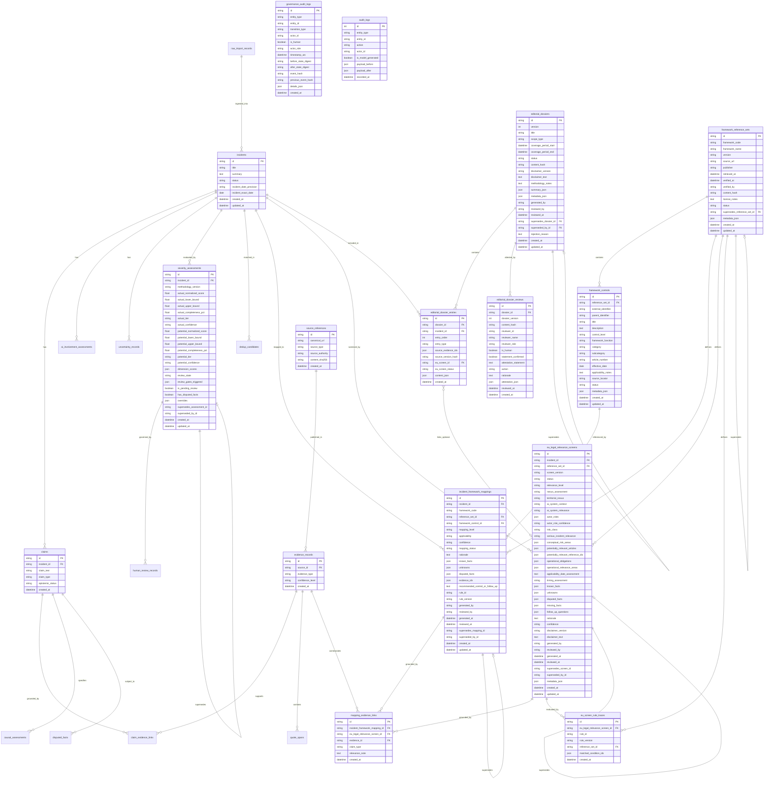

# Relational Entity-Relationship (ER) Diagram
**Project:** AI Incident Monitor
**Organization:** AI Guardians LLC
**Document Identifier:** DOC-ERD-001
**Milestone:** Phase 6A (Editorial Dossier Foundation & Review CLI)
**Status:** ACTIVE

---

## 1. Relational Database Schema Overview

The AI Incident Monitor persistence foundation comprises 25 relational tables managed via SQLAlchemy 2.0 ORM and Alembic migrations:
- **Core Entities**: `incidents`, `claims`, `evidence_records`, `source_references`, `quote_spans`, `claim_evidence_links`
- **Epistemic & Causal Layer**: `causal_assessments`, `ai_involvement_assessments`, `uncertainty_records`, `disputed_facts`
- **Assessment & Severity Layer**: `severity_assessments`
- **Governance Framework Mapping Layer (Migrations 003, 004, 005)**: `framework_reference_sets`, `framework_controls`, `incident_framework_mappings`, `eu_legal_relevance_screens`, `eu_screen_rule_traces`, `mapping_evidence_links`, `governance_audit_logs`
- **Editorial Pipeline & Dossier Layer (Migration 006)**: `editorial_dossiers`, `editorial_dossier_entries`, `editorial_dossier_reviews`
- **Ingestion & Deduplication Layer**: `raw_import_records`, `dedup_candidates`
- **Governance & Audit Trail**: `human_review_records`, `audit_logs`, `governance_audit_logs`

---

## 2. Mermaid Entity-Relationship Diagram

