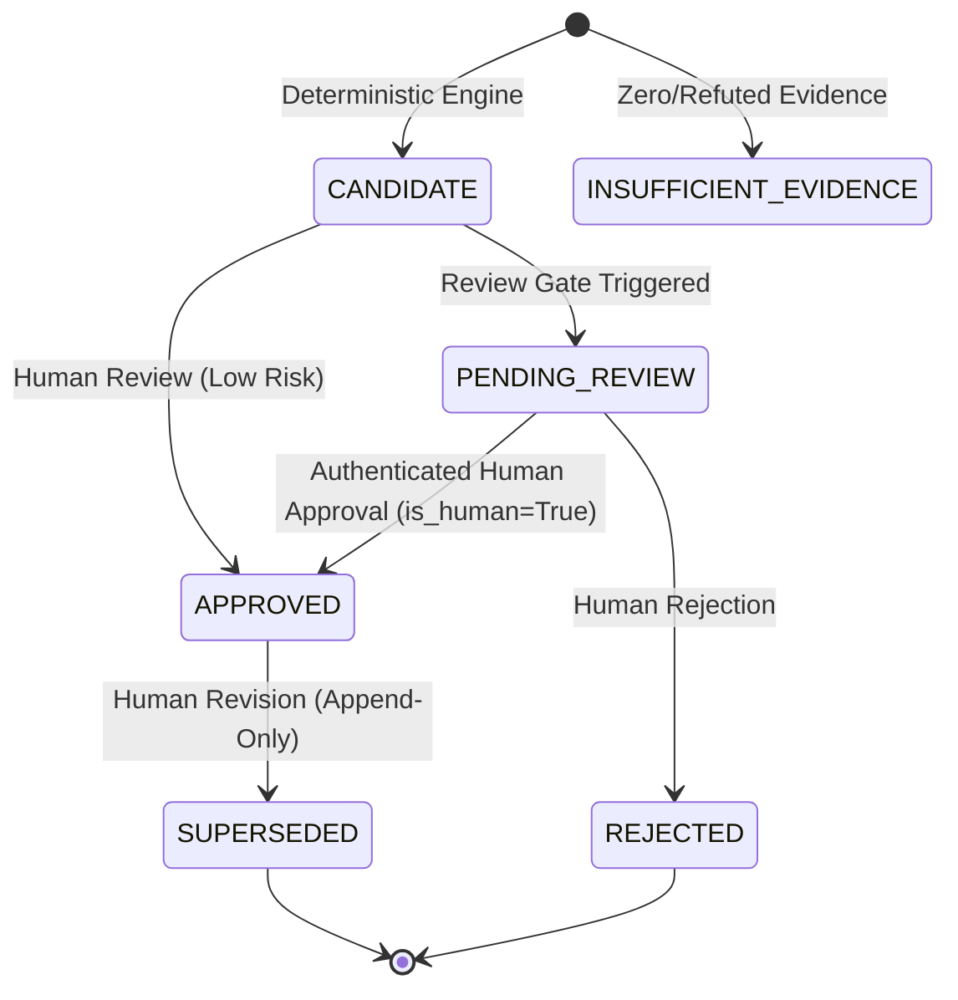

# AI Guardians Governance Framework Mapping Methodology
**Document Identifier:** METH-002  
**Effective Date:** 2026-10-21  
**Version:** 1.0.0  
**Scope:** OECD AI Principles (2024 Update) & NIST AI Risk Management Framework (RMF 1.0)  
**Governing Documents:** [`docs/PROJECT_CONSTITUTION.md`](PROJECT_CONSTITUTION.md), [`docs/PRODUCT_REQUIREMENTS.md`](PRODUCT_REQUIREMENTS.md), [`docs/DECISIONS.md`](DECISIONS.md) (ADR-013, ADR-014, ADR-016)

---

## 1. Executive Summary & Constitutional Principles

The AI Guardians Governance Mapping Engine is a pure, deterministic, evidence-grounded system that connects verified incident facts to authoritative international AI governance standards. The engine is engineered around non-negotiable safety and epistemic principles:

1. **Evidence First (Safety Rule 1):**  
   Every governance mapping must link to one or more verified, primary or corroborated evidence records from the incident. If zero evidence records are available, the engine produces zero mappings. Mappings are strictly prohibited from existing as ungrounded editorial conjectures.
2. **Anti-Fabrication & Reference Integrity (Safety Rule 2):**  
   The engine maps only to identifiers present in the cryptographically verified reference library (`frameworks/manifest.json`). It strictly rejects unknown, malformed, inactive, or fabricated identifiers, and never constructs external identifiers through heuristics or generative inference.
3. **Pure Determinism (Safety Rule 3):**  
   Identical incident facts, evidence records, and reference versions always produce identical mapping candidates. The engine executes zero external network requests, zero web scraping, and zero generative language model calls.
4. **Orthogonal Decoupling (Safety Rule 4 & GOV-005):**  
   Governance framework alignment is strictly orthogonal to AIG-ISI technical incident severity. A high severity score never forces or upgrades a governance mapping, and governance alignment never alters AIG-ISI severity, completeness, or confidence.
5. **Preservation of Epistemic Uncertainty (Safety Rule 5):**  
   Material unknowns remain explicit unknowns. Disputed facts remain explicit disputed facts. Low confidence is never artificially upgraded by inference.
6. **Mandatory Human-in-the-Loop Review (Constitutional Rules 12 & 13):**  
   Automated algorithms and LLMs cannot approve governance mappings. Formal approval strictly requires an authenticated human reviewer identity with `is_human=True`. Revisions never mutate approved records in place, but create append-only superseding records backed by a cryptographic audit trail.
7. **Strict Exclusion of Legal Conclusion Language (Safety Rule 7 & LGL-001):**  
   Mappings represent factual observations of governance relevance, control gaps, or broader institutional lessons. Rationales, fact items, and metadata are programmatically validated to ensure they contain no judicial or statutory determinations (`violation`, `breach`, `illegal`, `unlawful`, `compliant`, `noncompliant`, `statutory duty`).

---

## 2. Supported Frameworks & Controlled Vocabularies

### 2.1 OECD AI Principles (2024 Update)

The engine evaluates incident context against the five core principles updated in May 2024:

* **OECD-P1.1 (Inclusive growth, sustainable development, and well-being):** Societal, ecological, environmental, and public well-being externalities.
* **OECD-P1.2 (Human rights and democratic values, including fairness and privacy):** Demographic disparities, algorithmic bias, privacy compromise, unauthorized surveillance, or fundamental rights deprivations.
* **OECD-P1.3 (Transparency and explainability):** Opaque model architectures, lack of explainable rationale, absent user disclosure, or missing contestability mechanisms.
* **OECD-P1.4 (Robustness, security, and safety):** Systemic technical instability, physical/operational safety hazards, adversarial manipulation, prompt injection vulnerabilities, or critical operational failures.
* **OECD-P1.5 (Accountability):** Unassigned organizational responsibility, absence of human oversight, delayed remediation, or failure of incident response.

#### Controlled Applicability Values (OECD):
* `DIRECTLY_IMPLICATED`: Empirical evidence documents direct engagement with the principle's core requirements.
* `BROADER_GOVERNANCE_LESSON`: The incident facts do not establish direct operational compromise but provide systemic governance insights.
* `INSUFFICIENT_EVIDENCE`: Evidentiary basis is inadequate to substantiate alignment.
* `NOT_APPLICABLE`: Principle is irrelevant to the factual operational context.

---

### 2.2 NIST AI Risk Management Framework (AI RMF 1.0)

The engine evaluates incident context across the NIST AI RMF core lifecycle functions:

* **NIST-GOVERN:** Organizational culture, risk management policies, leadership oversight, and cross-functional governance structures.
* **NIST-MAP:** Operational context framing, deployment environment boundaries, intended purpose documentation, and characterization of affected populations.
* **NIST-MEASURE:** Testing, evaluation, verification, and validation (TEVV), quantitative trustworthiness metric tracking, and ongoing monitoring.
* **NIST-MANAGE:** Risk prioritization, mitigation enactment, incident response playbooks, rollback procedures, and hazard treatment (treat, transfer, tolerate, terminate).

#### Strict Structural Hierarchy:
$$\text{Function} \longrightarrow \text{Category} \longrightarrow \text{Subcategory}$$

* A Category mapping must store and validate its parent Function.
* A Subcategory mapping must store and validate both its parent Category and top-level Function.
* **Specificity Constraint:** Subcategories (e.g., `GOVERN 1.1`, `MAP 1.1`, `MEASURE 2.1`, `MANAGE 1.1`) require at least one verified `HIGHLY_SPECIFIC` primary evidence record. When evidence is general or high-level, mapping candidates are constrained to Category or Function level.

#### Controlled Applicability Values (NIST):
* `OBSERVED_CONTROL_GAP`: Factual evidence documents that the control was absent, deficient, or bypassed.
* `EFFECTIVE_MITIGATION_OBSERVED`: Evidence indicates the control was successfully enacted and mitigated risk.
* `POTENTIAL_RISK_MANAGEMENT_LESSON`: Incident context indicates organizational improvements without definitive proof of prior failure.
* `INSUFFICIENT_EVIDENCE`: Evidentiary basis is inadequate to substantiate control alignment.
* `NOT_APPLICABLE`: Control is outside the operational boundary of the AI system.

---

## 3. Deterministic Confidence Scoring Model

Evidentiary confidence is computed independently for each mapping candidate on a normalized 0.0 to 100.0 scale, combining four positive quality metrics and three uncertainty penalties:

### 3.1 Base Metrics

1. **Evidence Quantity ($C_{\text{count}}$, max 40 points):**
   * 1 evidence item: $25.0$ points
   * 2 evidence items: $33.0$ points
   * 3+ evidence items: $40.0$ points
2. **Directness Score ($C_{\text{dir}}$, max 25 points):**
   * `PRIMARY_DIRECT`: $25.0$ points
   * `PRIMARY_OBSERVATIONAL`: $20.0$ points
   * `SECONDARY_DERIVED`: $15.0$ points
   * `HEARSAY_OR_ANECDOTAL`: $5.0$ points
3. **Corroboration Score ($C_{\text{corr}}$, max 20 points):**
   * `FULLY_CORROBORATED`: $20.0$ points
   * `PARTIALLY_CORROBORATED`: $15.0$ points
   * `SINGLE_SOURCE_UNCONTESTED`: $10.0$ points
   * `CONTESTED` / `DISPUTED`: $5.0$ points
   * `REFUTED`: $0.0$ points (forces level to `INSUFFICIENT`)
4. **Specificity Score ($C_{\text{spec}}$, max 15 points):**
   * `HIGHLY_SPECIFIC`: $15.0$ points
   * `MODERATELY_SPECIFIC`: $10.0$ points
   * `GENERAL_SYSTEM_DESCRIPTION`: $3.0$ points

$$\text{Raw Score} = C_{\text{count}} + \bar{C}_{\text{dir}} + \bar{C}_{\text{corr}} + \bar{C}_{\text{spec}}$$

### 3.2 Epistemic Penalties

* **Unknowns Penalty ($P_{\text{unknown}}$):** Deducts $15.0$ points if material facts remain unverified.
* **Disputed Facts Penalty ($P_{\text{dispute}}$):** Deducts $25.0$ points if core claims are disputed or contradictory. Caps confidence at `MEDIUM`.
* **Granularity Penalty ($P_{\text{gran}}$):** For Subcategory mappings, deducts $15.0$ points if average specificity is moderate ($<12.0$), or $30.0$ points if all evidence is vague.

$$\text{Final Score} = \max\left(0.0, \, \text{Raw Score} - (P_{\text{unknown}} + P_{\text{dispute}} + P_{\text{gran}})\right)$$

### 3.3 Confidence Levels

* **`HIGH`** ($\ge 75.0$): High-quality, corroborated primary evidence meeting specific rule criteria.
* **`MEDIUM`** ($50.0 - 74.9$): Moderate evidence backing with minor unknowns or single-source verification.
* **`LOW`** ($25.0 - 49.9$): Lower evidentiary density, material unknowns, or disputed assertions.
* **`INSUFFICIENT`** ($< 25.0$ or refuted): Fails minimum threshold for reliable alignment.

---

## 4. Review State Machine & Gatekeeper Routing

Candidate mappings enter a formal state machine to ensure human governance over algorithmic outputs:

### 4.1 Mandatory Review Gates

A mapping is automatically routed to `PENDING_REVIEW` if any of the following gates trigger:

1. **`GOV_GATE_SPECIFIC_GRANULARITY`:** Mapping targets a Category or Subcategory control, requiring expert scrutiny of granular alignment.
2. **`GOV_GATE_DISPUTED_EVIDENCE`:** Incident context contains contested assertions or conflicting evidence records.
3. **`GOV_GATE_LOW_CONFIDENCE`:** Evidentiary confidence score evaluates to `LOW` or `INSUFFICIENT`.
4. **`GOV_GATE_SENSITIVE_DOMAIN`:** Incident facts implicate protected or high-stakes domains:
   * Health and safety
   * Biometric identification or categorisation
   * Law enforcement and criminal justice
   * Critical infrastructure
   * Employment and worker management
   * Access to credit and essential private services
   * Educational admissions and evaluation
   * Fundamental democratic processes
5. **`GOV_GATE_REVIEWER_EDIT`:** Manual modification of an automated candidate.

---

## 5. Persistence, Immutability & Cryptographic Audit Chaining

All mappings and review actions are stored in relational persistence (Migration `004_oecd_nist_mapping_provenance.py`):

* **Rule Provenance:** Every mapping record stores the exact deterministic `rule_id` (e.g., `RULE-OECD-1.2-01`, `RULE-NIST-GOVERN-1.1-01`) and `rule_version` (`1.0.0`) that evaluated the candidate.
* **Normalized Evidence Junction:** Every mapped evidence item is stored in `mapping_evidence_links` with claim types and relevance notes.
* **Strict Immutability:** Direct in-place modification of approved records raises `ImmutabilityViolationError`.
* **Append-Only Supersession:** Revisions create a new mapping record referencing `supersedes_mapping_id`. The superseded record is transitioned to `SUPERSEDED` with `superseded_by_id`.
* **Cryptographic Audit Trail:** All state transitions generate immutable entries in `governance_audit_logs`, where:
  $$\text{event\_hash}_n = \text{SHA256}\left(\text{canonical\_json}(\text{payload}_n) \,\|\, \text{event\_hash}_{n-1}\right)$$
  ensuring tamper-evident, chronologically verifiable provenance across the entire lifecycle.

---

## 6. Regulation (EU) 2024/1689 Core Deterministic Fact Evaluators

Phase 5 Increment 2C-2 introduces deterministic, offline fact evaluators for preliminary informational screening under the EU AI Act. Evaluators operate strictly on verified incident facts without generative inference or legal determinations:

### 6.1 Rule Family A: Territorial and Market Nexus (Article 2)

* **`RULE-EU-NEXUS-01` (EU Establishment):** Evaluates whether the AI system provider or deployer is established, incorporated, or located in an EU Member State (`POSSIBLE_EU_NEXUS`).
* **`RULE-EU-NEXUS-02` (Market Placement / Putting into Service):** Evaluates commercial distribution, marketing, or operational deployment within EU territory (`POSSIBLE_EU_NEXUS`).
* **`RULE-EU-NEXUS-03` (Third-Country Output Used in the Union):** Evaluates scenarios where an external AI system's outputs (predictions, recommendations, content, decisions) are used in the EU or affect persons located in the EU (`POSSIBLE_EU_NEXUS`).
* **`RULE-EU-NEXUS-04` (Absence / Foreign Scope / Insufficiency):** Evaluates absence of nexus:
  * Exclusively non-EU deployment $\rightarrow$ `OUTSIDE_APPARENT_TERRITORIAL_SCOPE`
  * Zero EU nexus indicators in evidence $\rightarrow$ `NO_EU_NEXUS_EVIDENCE`
  * Inadequate geographic information $\rightarrow$ `INSUFFICIENT_NEXUS_INFORMATION`

### 6.2 Rule Family B: AI System Definitional Context (Article 3(1))

* **`RULE-EU-AISYS-01` (Meets AI System Definition):** Factual evidence documents machine-based inferencing from inputs to generate outputs influencing physical/virtual environments with varying autonomy (`MEETS_DEFINITION`).
* **`RULE-EU-AISYS-02` (Borderline / Unclear Autonomy):** Algorithmic scoring, heuristic rules, or expert systems with ambiguous degrees of autonomous inference (`BORDERLINE_OR_UNCLEAR`).
* **`RULE-EU-AISYS-03` (Classical Software / Non-AI):** Deterministic procedural scripts, static databases, or traditional business rules lacking inferencing mechanisms (`OUTSIDE_DEFINITION`).

### 6.3 Rule Family C: Actor Role Attribution (Article 3(2)–(8))

* **`RULE-EU-ROLE-01` (Provider):** Developed, trained, branded, or placed AI system on market under own trademark (`PROVIDER`).
* **`RULE-EU-ROLE-02` (Deployer):** Utilized AI system under own authority in operational/professional activity (`DEPLOYER`).
* **`RULE-EU-ROLE-03` (Importer / Distributor):** Supply chain intermediaries (`IMPORTER`, `DISTRIBUTOR`).
* **`RULE-EU-ROLE-04` (GPAI Model Provider):** Upstream foundation model provision (`GPAI_MODEL_PROVIDER`).
* **Actor Role Confidence Resolution:**
  * `IDENTIFIED_FROM_EVIDENCE`: Corroborated primary records directly attribute operator roles.
  * `POSSIBLE_FROM_EVIDENCE`: Single uncorroborated source or contextual inference.
  * `DISPUTED`: Contested roles across evidence sources or disputed claims.
  * `UNKNOWN`: Missing or unestablished role attribution.

### 6.4 Temporal Alignment Evaluator

* **`RULE-EU-TEMPORAL-01`:** Compares verified incident occurrence dates against statutory effective dates recorded in reference metadata (`2026-08-02`, `2025-02-02`):
  * Incident date on or after statutory effective date $\rightarrow$ `REFERENCE_METADATA_ALIGNS`
  * Incident date predates statutory application $\rightarrow$ `TEMPORAL_CONTEXT_REQUIRES_REVIEW`
  * Incident date unknown $\rightarrow$ `INCIDENT_DATE_UNKNOWN`
  * Statutory effective date missing or ambiguous $\rightarrow$ `EFFECTIVE_DATE_UNCERTAIN`

### 6.5 Rule Family E: Missing Facts & Neutral Follow-Up Questions

* **`RULE-EU-QUESTIONS-01`:** Analyzes evaluated epistemic voids across nexus, technical autonomy, actor roles, and occurrence timing. Generates neutral, non-leading inquiries and missing fact statements for human investigators.
* **Strict Non-Judicial Phrasing:** All questions, missing facts, and rationales are validated against `validate_no_legal_language`, ensuring strict exclusion of legal violation terminology.

---

## 7. Regulation (EU) 2024/1689 Deterministic Conceptual Relevance Engine (Increment 2C-3A)

Phase 5 Increment 2C-3A implements a pure, deterministic, evidence-grounded conceptual relevance engine (`EURelevanceScreeningEngine`) evaluating verified incident facts against canonical controls in `frameworks/eu-ai-act/eu-ai-act-2024-1689.yaml`.

### 7.1 Non-Negotiable Safety & Epistemic Boundaries

1. **Informational Screening ONLY:** Evaluations identify conceptual correspondence to statutory themes. They do **NOT** determine legal applicability, territorial jurisdiction, operator classification, compliance, noncompliance, liability, breach, or violation.
2. **Evidence First (Safety Rule 1):** Zero verified incident evidence records unconditionally yield zero affirmative conceptual findings.
3. **Validated References Only (Safety Rule 2):** Every conceptual rule and finding maps strictly to an active identifier in the cryptographic reference library (`frameworks/manifest.json`). Invented or unvalidated identifiers trigger a `ConstitutionalViolationError`.
4. **Epistemic Modesty (Safety Rule 5):** Absent evidence is never interpreted as a negative finding; it is preserved as an explicit unknown.
5. **Preservation of Disputed Facts:** Contested evidence remains visible, caps confidence at `LOW`, and forces human review.
6. **Mandatory PENDING_REVIEW (Safety Rule 7):** Every screen and conceptual finding unconditionally enters `PENDING_REVIEW`. No automated process may approve, publish, distribute, or declare a screen eligible for external use.
7. **Strict Lexical Invariants:** All generated rationales, known facts, and metadata items are validated against `validate_no_legal_language`. Prohibited terms include: `violation`, `breach`, `illegal`, `unlawful`, `legally required`, `statutory duty`, `obligation applies`, `must report`, `liable`, `liability`, `high-risk`, `prohibited`, `subject to an obligation`, `reportable`, `compliant`, `noncompliant`.
8. **Decoupled Confidence:** Governance screening confidence is calculated independently from AIG-ISI severity and OECD/NIST confidence.

### 7.2 Controlled Conceptual Relevance Ratings

Each evaluated concept is categorized with a controlled informational rating:
* `POTENTIALLY_RELEVANT_FOR_QUALIFIED_REVIEW`: Verified facts correspond directly to statutory control themes, requiring expert scrutiny.
* `CONCEPTUALLY_RELEVANT`: Incident facts engage with regulated domain, transparency, or operational control concepts.
* `INSUFFICIENT_INFORMATION`: Available evidence is inadequate to evaluate correspondence.
* `NOT_APPARENTLY_RELEVANT`: Documented facts do not demonstrate engagement with the conceptual scope.
* `NOT_APPLICABLE_TO_RECORDED_CONTEXT`: Concept is demonstrably outside the technical or operational boundaries of the incident.

### 7.3 Conceptual Rule Families (28 Specific Canonical Rules)

#### Rule Family D1: Article 5 Prohibited Practice Concepts
* **`RULE-EU-CONC-PROHIB-01` (EU-ART-5.1.a):** Subliminal, manipulative, or deceptive behavioral distortion techniques.
* **`RULE-EU-CONC-PROHIB-02` (EU-ART-5.1.b):** Exploitation of age, disability, or socio-economic vulnerabilities.
* **`RULE-EU-CONC-PROHIB-03` (EU-ART-5.1.c):** Evaluation or classification based on social behavior (social scoring).
* **`RULE-EU-CONC-PROHIB-04` (EU-ART-5.1.d):** Predictive policing or individual criminal risk assessments based solely on profiling.
* **`RULE-EU-CONC-PROHIB-05` (EU-ART-5.1.e):** Untargeted facial image scraping from the internet or CCTV streams.
* **`RULE-EU-CONC-PROHIB-06` (EU-ART-5.1.f):** Workplace or educational institution emotion recognition.
* **`RULE-EU-CONC-PROHIB-07` (EU-ART-5.1.g):** Biometric categorization deducing race, political beliefs, or sensitive traits.
* **`RULE-EU-CONC-PROHIB-08` (EU-ART-5.1.h):** Real-time remote biometric identification in publicly accessible spaces.

#### Rule Family D2: Annex III Regulated Operational Domain Concepts
* **`RULE-EU-CONC-ANNEX3-01` (EU-ANNEX-III.1):** Remote biometric identification and categorization in permitted contexts.
* **`RULE-EU-CONC-ANNEX3-02` (EU-ANNEX-III.2):** Safety components in critical physical or digital infrastructure.
* **`RULE-EU-CONC-ANNEX3-03` (EU-ANNEX-III.3):** Educational admissions, grading, vocational placement, or automated proctoring.
* **`RULE-EU-CONC-ANNEX3-04` (EU-ANNEX-III.4):** Recruitment screening, job targeting, task allocation, or worker monitoring.
* **`RULE-EU-CONC-ANNEX3-05` (EU-ANNEX-III.5):** Credit scoring, health/life insurance risk pricing, or essential public assistance eligibility.
* **`RULE-EU-CONC-ANNEX3-06` (EU-ANNEX-III.6):** Law enforcement individual risk assessments, polygraphs, or evidence evaluation.
* **`RULE-EU-CONC-ANNEX3-07` (EU-ANNEX-III.7):** Border control, asylum examination, visa adjudication, or traveller verification.
* **`RULE-EU-CONC-ANNEX3-08` (EU-ANNEX-III.8):** Judicial research, alternative dispute resolution, or democratic/electoral processes.

#### Rule Family D3: Article 50 Transparency Concepts
* **`RULE-EU-CONC-TRANSP-01` (EU-ART-50.1):** Direct AI-to-human interaction disclosure (conversational chatbots/assistants).
* **`RULE-EU-CONC-TRANSP-02` (EU-ART-50.2):** Synthetic media, deepfake generation, likeness manipulation, or voice cloning.
* **`RULE-EU-CONC-TRANSP-04` (EU-ART-50.4):** AI-generated or manipulated public informational text on matters of public interest.

#### Rule Family D4: General-Purpose AI Concepts (Articles 51 & 53)
* **`RULE-EU-CONC-GPAI-01` (EU-ART-51):** High-compute foundation models ($>10^{25}\text{ FLOPs}$) or systemic risk surface.
* **`RULE-EU-CONC-GPAI-02` (EU-ART-53):** Technical documentation, copyright compliance policies, and training data summaries.

#### Rule Family D5: Operational Control Concepts (Articles 10, 12, 14, 15, 72, 73)
* **`RULE-EU-CONC-OPS-DATA` (EU-ART-10):** Training/testing data governance, dataset bias, and demographic curation.
* **`RULE-EU-CONC-OPS-LOGS` (EU-ART-12):** Automatic event recording, telemetry duration, and technical audit logging.
* **`RULE-EU-CONC-OPS-OVERSIGHT` (EU-ART-14):** Human oversight mechanisms, stop buttons, and automation bias mitigations.
* **`RULE-EU-CONC-OPS-ROBUST` (EU-ART-15):** Cybersecurity, prompt injection resilience, and adversarial robustness.
* **`RULE-EU-CONC-OPS-PMM` (EU-ART-72):** Post-market monitoring systems and field performance drift surveillance.
* **`RULE-EU-CONC-OPS-REPORTING` (EU-ART-73):** Incident escalation protocols and supervisory authority notifications.

#### Rule Family D6: Serious Incident Conceptual Relevance (Article 3(49))
* **`RULE-EU-CONC-SERIOUS-01` (EU-ART-3.49):** Serious harm criteria (death, severe health injury, critical infrastructure disruption, or fundamental rights impairment).

### 7.4 Engine Orchestration & Composite Screen Assembly

`EURelevanceScreeningEngine` orchestrates:
1. Pure fact context evaluation via `evaluate_eu_fact_context` (nexus, AI-system definition, operator roles, timing, epistemic gaps).
2. Pure conceptual relevance evaluation via `evaluate_eu_conceptual_context` (28 rules across 6 families).
3. Automatic parent control linkage (`EU-ART-5`, `EU-ART-6`, `EU-ART-50`).
4. Schema generation into `EULegalRelevanceScreenSchema` with `status=EUScreenStatus.PENDING_REVIEW`, mandatory disclaimer (`EU_AI_ACT_DISCLAIMER_V2`), fine-grained rule traces, and structured findings stored in `metadata_json["conceptual_findings"]`.
5. Cryptographic audit logging and relational persistence in `eu_legal_relevance_screens` and `eu_screen_rule_traces`.

### 7.5 Explicit Scope Boundary: Phase 5 Increment 2C-3B Deferred

Phase 5 Increment 2C-3A delivers the conceptual relevance engine only. Increment 2C-3B remains deferred and explicitly out of scope:
* No output linter (`eu_output_linter.py`) has been added.
* Final external-use output eligibility enforcement is deferred to 2C-3B.
* Reviewer attestation validation beyond existing 2C-1 mechanics is deferred to 2C-3B.
* No publishing, Substack, API route, or UI integration exists.

