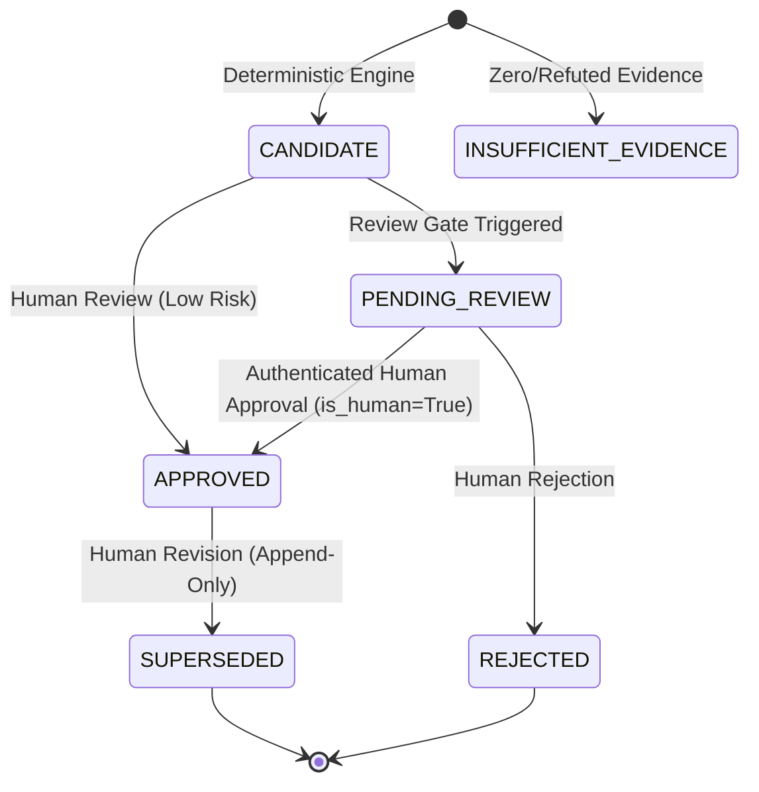

# AI Guardians Governance Framework Mapping Methodology
**Document Identifier:** METH-002  
**Effective Date:** 2026-10-21  
**Version:** 1.0.0  
**Scope:** OECD AI Principles (2024 Update) & NIST AI Risk Management Framework (RMF 1.0)  
**Governing Documents:** [`docs/PROJECT_CONSTITUTION.md`](PROJECT_CONSTITUTION.md), [`docs/PRODUCT_REQUIREMENTS.md`](PRODUCT_REQUIREMENTS.md), [`docs/DECISIONS.md`](DECISIONS.md) (ADR-013, ADR-014, ADR-016)

---

## 1. Executive Summary & Constitutional Principles

The AI Guardians Governance Mapping Engine is a pure, deterministic, evidence-grounded system that connects verified incident facts to authoritative international AI governance standards. The engine is engineered around non-negotiable safety and epistemic principles:

1. **Evidence First (Safety Rule 1):**  
   Every governance mapping must link to one or more verified, primary or corroborated evidence records from the incident. If zero evidence records are available, the engine produces zero mappings. Mappings are strictly prohibited from existing as ungrounded editorial conjectures.
2. **Anti-Fabrication & Reference Integrity (Safety Rule 2):**  
   The engine maps only to identifiers present in the cryptographically verified reference library (`frameworks/manifest.json`). It strictly rejects unknown, malformed, inactive, or fabricated identifiers, and never constructs external identifiers through heuristics or generative inference.
3. **Pure Determinism (Safety Rule 3):**  
   Identical incident facts, evidence records, and reference versions always produce identical mapping candidates. The engine executes zero external network requests, zero web scraping, and zero generative language model calls.
4. **Orthogonal Decoupling (Safety Rule 4 & GOV-005):**  
   Governance framework alignment is strictly orthogonal to AIG-ISI technical incident severity. A high severity score never forces or upgrades a governance mapping, and governance alignment never alters AIG-ISI severity, completeness, or confidence.
5. **Preservation of Epistemic Uncertainty (Safety Rule 5):**  
   Material unknowns remain explicit unknowns. Disputed facts remain explicit disputed facts. Low confidence is never artificially upgraded by inference.
6. **Mandatory Human-in-the-Loop Review (Constitutional Rules 12 & 13):**  
   Automated algorithms and LLMs cannot approve governance mappings. Formal approval strictly requires an authenticated human reviewer identity with `is_human=True`. Revisions never mutate approved records in place, but create append-only superseding records backed by a cryptographic audit trail.
7. **Strict Exclusion of Legal Conclusion Language (Safety Rule 7 & LGL-001):**  
   Mappings represent factual observations of governance relevance, control gaps, or broader institutional lessons. Rationales, fact items, and metadata are programmatically validated to ensure they contain no judicial or statutory determinations (`violation`, `breach`, `illegal`, `unlawful`, `compliant`, `noncompliant`, `statutory duty`).

---

## 2. Supported Frameworks & Controlled Vocabularies

### 2.1 OECD AI Principles (2024 Update)

The engine evaluates incident context against the five core principles updated in May 2024:

* **OECD-P1.1 (Inclusive growth, sustainable development, and well-being):** Societal, ecological, environmental, and public well-being externalities.
* **OECD-P1.2 (Human rights and democratic values, including fairness and privacy):** Demographic disparities, algorithmic bias, privacy compromise, unauthorized surveillance, or fundamental rights deprivations.
* **OECD-P1.3 (Transparency and explainability):** Opaque model architectures, lack of explainable rationale, absent user disclosure, or missing contestability mechanisms.
* **OECD-P1.4 (Robustness, security, and safety):** Systemic technical instability, physical/operational safety hazards, adversarial manipulation, prompt injection vulnerabilities, or critical operational failures.
* **OECD-P1.5 (Accountability):** Unassigned organizational responsibility, absence of human oversight, delayed remediation, or failure of incident response.

#### Controlled Applicability Values (OECD):
* `DIRECTLY_IMPLICATED`: Empirical evidence documents direct engagement with the principle's core requirements.
* `BROADER_GOVERNANCE_LESSON`: The incident facts do not establish direct operational compromise but provide systemic governance insights.
* `INSUFFICIENT_EVIDENCE`: Evidentiary basis is inadequate to substantiate alignment.
* `NOT_APPLICABLE`: Principle is irrelevant to the factual operational context.

---

### 2.2 NIST AI Risk Management Framework (AI RMF 1.0)

The engine evaluates incident context across the NIST AI RMF core lifecycle functions:

* **NIST-GOVERN:** Organizational culture, risk management policies, leadership oversight, and cross-functional governance structures.
* **NIST-MAP:** Operational context framing, deployment environment boundaries, intended purpose documentation, and characterization of affected populations.
* **NIST-MEASURE:** Testing, evaluation, verification, and validation (TEVV), quantitative trustworthiness metric tracking, and ongoing monitoring.
* **NIST-MANAGE:** Risk prioritization, mitigation enactment, incident response playbooks, rollback procedures, and hazard treatment (treat, transfer, tolerate, terminate).

#### Strict Structural Hierarchy:
$$\text{Function} \longrightarrow \text{Category} \longrightarrow \text{Subcategory}$$

* A Category mapping must store and validate its parent Function.
* A Subcategory mapping must store and validate both its parent Category and top-level Function.
* **Specificity Constraint:** Subcategories (e.g., `GOVERN 1.1`, `MAP 1.1`, `MEASURE 2.1`, `MANAGE 1.1`) require at least one verified `HIGHLY_SPECIFIC` primary evidence record. When evidence is general or high-level, mapping candidates are constrained to Category or Function level.

#### Controlled Applicability Values (NIST):
* `OBSERVED_CONTROL_GAP`: Factual evidence documents that the control was absent, deficient, or bypassed.
* `EFFECTIVE_MITIGATION_OBSERVED`: Evidence indicates the control was successfully enacted and mitigated risk.
* `POTENTIAL_RISK_MANAGEMENT_LESSON`: Incident context indicates organizational improvements without definitive proof of prior failure.
* `INSUFFICIENT_EVIDENCE`: Evidentiary basis is inadequate to substantiate control alignment.
* `NOT_APPLICABLE`: Control is outside the operational boundary of the AI system.

---

## 3. Deterministic Confidence Scoring Model

Evidentiary confidence is computed independently for each mapping candidate on a normalized 0.0 to 100.0 scale, combining four positive quality metrics and three uncertainty penalties:

### 3.1 Base Metrics

1. **Evidence Quantity ($C_{\text{count}}$, max 40 points):**
   * 1 evidence item: $25.0$ points
   * 2 evidence items: $33.0$ points
   * 3+ evidence items: $40.0$ points
2. **Directness Score ($C_{\text{dir}}$, max 25 points):**
   * `PRIMARY_DIRECT`: $25.0$ points
   * `PRIMARY_OBSERVATIONAL`: $20.0$ points
   * `SECONDARY_DERIVED`: $15.0$ points
   * `HEARSAY_OR_ANECDOTAL`: $5.0$ points
3. **Corroboration Score ($C_{\text{corr}}$, max 20 points):**
   * `FULLY_CORROBORATED`: $20.0$ points
   * `PARTIALLY_CORROBORATED`: $15.0$ points
   * `SINGLE_SOURCE_UNCONTESTED`: $10.0$ points
   * `CONTESTED` / `DISPUTED`: $5.0$ points
   * `REFUTED`: $0.0$ points (forces level to `INSUFFICIENT`)
4. **Specificity Score ($C_{\text{spec}}$, max 15 points):**
   * `HIGHLY_SPECIFIC`: $15.0$ points
   * `MODERATELY_SPECIFIC`: $10.0$ points
   * `GENERAL_SYSTEM_DESCRIPTION`: $3.0$ points

$$\text{Raw Score} = C_{\text{count}} + \bar{C}_{\text{dir}} + \bar{C}_{\text{corr}} + \bar{C}_{\text{spec}}$$

### 3.2 Epistemic Penalties

* **Unknowns Penalty ($P_{\text{unknown}}$):** Deducts $15.0$ points if material facts remain unverified.
* **Disputed Facts Penalty ($P_{\text{dispute}}$):** Deducts $25.0$ points if core claims are disputed or contradictory. Caps confidence at `MEDIUM`.
* **Granularity Penalty ($P_{\text{gran}}$):** For Subcategory mappings, deducts $15.0$ points if average specificity is moderate ($<12.0$), or $30.0$ points if all evidence is vague.

$$\text{Final Score} = \max\left(0.0, \, \text{Raw Score} - (P_{\text{unknown}} + P_{\text{dispute}} + P_{\text{gran}})\right)$$

### 3.3 Confidence Levels

* **`HIGH`** ($\ge 75.0$): High-quality, corroborated primary evidence meeting specific rule criteria.
* **`MEDIUM`** ($50.0 - 74.9$): Moderate evidence backing with minor unknowns or single-source verification.
* **`LOW`** ($25.0 - 49.9$): Lower evidentiary density, material unknowns, or disputed assertions.
* **`INSUFFICIENT`** ($< 25.0$ or refuted): Fails minimum threshold for reliable alignment.

---

## 4. Review State Machine & Gatekeeper Routing

Candidate mappings enter a formal state machine to ensure human governance over algorithmic outputs:

### 4.1 Mandatory Review Gates

A mapping is automatically routed to `PENDING_REVIEW` if any of the following gates trigger:

1. **`GOV_GATE_SPECIFIC_GRANULARITY`:** Mapping targets a Category or Subcategory control, requiring expert scrutiny of granular alignment.
2. **`GOV_GATE_DISPUTED_EVIDENCE`:** Incident context contains contested assertions or conflicting evidence records.
3. **`GOV_GATE_LOW_CONFIDENCE`:** Evidentiary confidence score evaluates to `LOW` or `INSUFFICIENT`.
4. **`GOV_GATE_SENSITIVE_DOMAIN`:** Incident facts implicate protected or high-stakes domains:
   * Health and safety
   * Biometric identification or categorisation
   * Law enforcement and criminal justice
   * Critical infrastructure
   * Employment and worker management
   * Access to credit and essential private services
   * Educational admissions and evaluation
   * Fundamental democratic processes
5. **`GOV_GATE_REVIEWER_EDIT`:** Manual modification of an automated candidate.

---

## 5. Persistence, Immutability & Cryptographic Audit Chaining

All mappings and review actions are stored in relational persistence (Migration `004_oecd_nist_mapping_provenance.py`):

* **Rule Provenance:** Every mapping record stores the exact deterministic `rule_id` (e.g., `RULE-OECD-1.2-01`, `RULE-NIST-GOVERN-1.1-01`) and `rule_version` (`1.0.0`) that evaluated the candidate.
* **Normalized Evidence Junction:** Every mapped evidence item is stored in `mapping_evidence_links` with claim types and relevance notes.
* **Strict Immutability:** Direct in-place modification of approved records raises `ImmutabilityViolationError`.
* **Append-Only Supersession:** Revisions create a new mapping record referencing `supersedes_mapping_id`. The superseded record is transitioned to `SUPERSEDED` with `superseded_by_id`.
* **Cryptographic Audit Trail:** All state transitions generate immutable entries in `governance_audit_logs`, where:
  $$\text{event\_hash}_n = \text{SHA256}\left(\text{canonical\_json}(\text{payload}_n) \,\|\, \text{event\_hash}_{n-1}\right)$$
  ensuring tamper-evident, chronologically verifiable provenance across the entire lifecycle.
