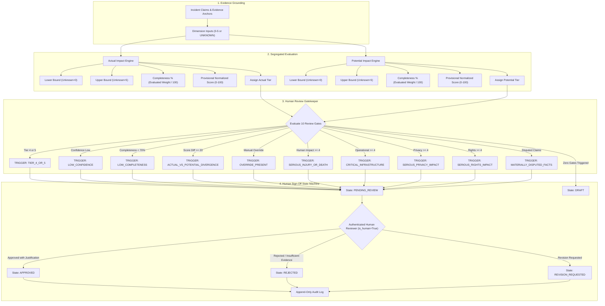

# AIG-ISI Scoring Flow and Review Gate Architecture
**Project:** AI Incident Monitor  
**Organization:** AI Guardians LLC  
**Document Identifier:** DOC-FLOW-001  
**Milestone:** Phase 5 Increment 1 (AIG-ISI Severity Foundation)  
**Status:** ACTIVE  

---

## 1. End-to-End Scoring Flow

The AIG-ISI deterministic scoring engine processes evaluated dimension scores for both Actual Impact and Potential Impact, evaluates mathematical bounds and completeness, routes through 10 mandatory review gates, and enforces authenticated human sign-off:

