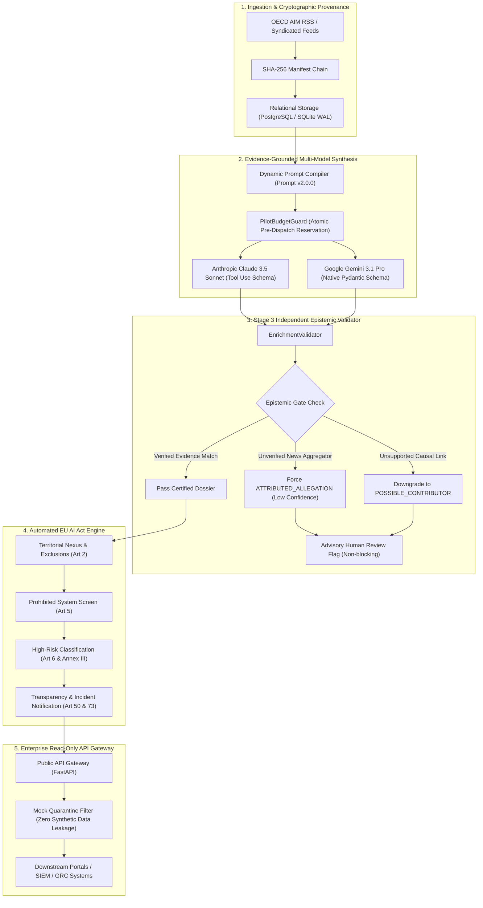
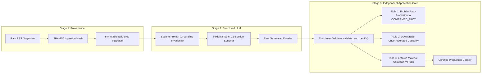
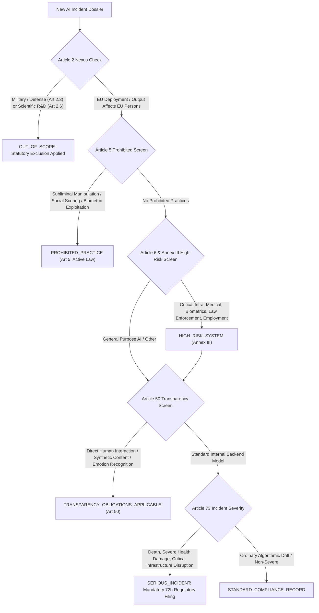

# Building an Autonomous AI Incident Monitor & EU AI Act Compliance Engine

### *How to transform unstructured AI failure feeds into forensic postmortems, statutory regulatory audits, and defensive playbooks—without hallucinating causality.*

---

**By: Platform Engineering & AI Safety Architecture Team**  
*Published in Applied AI Systems & Governance Engineering*  
*Repository: [github.com/EbeDenver/AIG-AI-Incident-Monitor](https://github.com/EbeDenver/AIG-AI-Incident-Monitor)*

---

## 1. The Enterprise AI Blindspot

Enterprise AI adoption has transitioned from experimental sandboxes to safety-critical production deployments: autonomous agents executing code, clinical decision-support models evaluating pathology scans, algorithmic pricing systems balancing commodities, and automated grid-load shedding.

Yet when an AI system fails in production, organizations face a double crisis:
1. **The Forensic Deficit**: Public reporting and internal incident reports are fragmented, sensationalized, and syndication-heavy. An aggregator headline screams *"AI Causes Fatal Collision,"* but engineers lack the system architecture, model weights, telemetry error codes, and sensor desynchronization data needed to determine whether the model was a **primary cause**, an **incidental bystander**, or an **unverified allegation**.
2. **The Regulatory Enforcement Wave**: With the European Union’s **EU AI Act** entering force (prohibitions active, Annex III high-risk compliance looming, and Article 73 mandatory serious incident notification clocks ticking), treating an algorithmic malfunction as a routine software bug creates immediate legal liability, board-level exposure, and regulatory penalties reaching up to €35M or 7% of global turnover.

To solve this, we architected and deployed the **AI Incident Monitor**—an open, production-grade intelligence platform designed to ingest unstructured incident streams (OECD AIM, incident databases, RSS feeds), apply strict epistemic and causal discipline via multi-model LLMs (Claude 3.5 Sonnet and Gemini 3.1 Pro), automate EU AI Act compliance assessments, and generate actionable defensive playbooks for practitioners.

Here is an architectural walkthrough of how it works, how it eliminates hallucinated causality, and how industry practitioners can deploy it today.

---

## 2. High-Level System Architecture

The AI Incident Monitor decouples raw data ingestion from evidence-grounded intelligence synthesis, subjecting every claim to automated validation before exposing it through a read-only public API:



---

## 3. The 3-Stage Epistemic Verification Pipeline

Most LLM summarizers fail in risk-critical environments because they confuse **allegations** with **corroborated facts**. If a blog claims *"Autonomous Drone Hacked via Prompt Injection,"* a naive model summarizes the hack as an objective reality. 

In forensic and legal settings, this is disastrous. We established a **3-Stage Epistemic Pipeline** governed by strict data integrity rules:



### The Three Epistemic Invariants

1. **Anti-Hallucination & Defect Prevention**:
   When source evidence consists solely of brief syndicated feed entries (<25 words) or single news wire citations without technical postmortems, all atomic claims are programmatically classified as `ATTRIBUTED_ALLEGATION` with `UNVERIFIED` status. The Stage 3 validator **strictly forbids** promoting secondary reporting to `CONFIRMED_FACT`.
2. **Causal Discipline**:
   An AI system's role cannot be designated as `CONFIRMED_CAUSE` without verified internal telemetry, architecture postmortems, or formal engineering audits. If evidence is lacking, the validator programmatically demotes causality to `POSSIBLE_CONTRIBUTOR` or `CAUSALITY_NOT_ESTABLISHED`.
3. **The No-Approval Policy (Continuous Operational Flow)**:
   Traditional GRC workflows fail because human approval queues create weeks of latency. The AI Incident Monitor implements an **advisory quality model**: missing evidence or epistemic violations raise structured advisory warnings (`advisory_human_review_flag: true`) and document explicit uncertainties, allowing downstream automated ingestion without blocking on human sign-off.

---

## 4. The EU AI Act Compliance Engine

Regulatory compliance cannot be an afterthought or a freeform LLM paragraph. The AI Incident Monitor features a deterministic statutory engine implementing the EU AI Act:



### Statutory Baseline Awareness (Late 2026 / 2027 Timeline)
The engine reflects active statutory reality:
* **Active Law (Enforced Today)**: Article 5 Prohibitions (banned manipulative/exploitative systems) and Article 50 Transparency rules.
* **Transitional Law (Enforced Dec 2, 2027)**: Annex III high-risk use-case classifications are tracked and surfaced, but flagged with status `NOT_YET_APPLICABLE` so legal teams do not misinterpret upcoming obligations as retroactive liabilities.
* **Mandatory Statutory Disclaimer**: Every public payload embeds an immutable disclaimer clarifying that assessments constitute automated technical triage, not formal legal advice.

---

## 5. Dual Guidance Framework: From Boardroom to Runbook

When an AI failure occurs, different stakeholders require vastly different data abstractions. The AI Incident Monitor produces a synchronized, dual-track advisory package:

```
┌────────────────────────────────────────────────────────────────────────┐
│                   AI INCIDENT INTELLIGENCE DOSSIER                     │
├───────────────────────────────────┬────────────────────────────────────┤
│   EXECUTIVE & DECISION-MAKER      │     TECHNICAL CONSULTANT &         │
│             GUIDANCE              │       DEFENSIVE PLAYBOOK           │
├───────────────────────────────────┼────────────────────────────────────┤
│ • Board Briefing Summary          │ • Discovery Questions for Triage   │
│ • Strategic Risk Priorities       │ • Boundary & Architecture Audit    │
│ • Budget Allocation Impact        │ • Concrete Control Implementations │
│ • Mean-Time-to-Detect (MTTD) Goals│ • Practical Failure Validation Test│
│ • Liability & Regulatory Exposure │ • Least-Privilege IAM Scoping      │
└───────────────────────────────────┴────────────────────────────────────┘
```

### Concrete Control Verification Example
Every control emitted in the dossier includes an automated or manual `validation_test`. For example, in an incident involving autonomous tool-use recursion:
* **Control**: *Implement deterministic transaction loop limiters and circuit breakers on autonomous agent runtimes.*
* **Control Type**: `PREVENTIVE`
* **Validation Test**: *Inject simulated recursive tool responses in staging; verify execution halts and raises `MaxRecursionExceeded` alert within 500ms without state corruption.*

---

## 6. The Production Tech Stack

The architecture is built for performance, air-tight isolation, and deterministic schema contracts:

| Layer | Component | Implementation Choice | Justification |
| :--- | :--- | :--- | :--- |
| **Language & Runtime** | Core Engine | **Python 3.13** | Native performance enhancements, modern typing support. |
| **API Framework** | Serving | **FastAPI** | High-performance asynchronous routing, automatic OpenAPI specification generation, WCAG-compliant design tokens. |
| **Validation & Schema** | Epistemic Gate | **Pydantic v2** | Native schema compilation, strict JSON typing, multi-tiered nested data transfer objects. |
| **LLM Provider 1** | Primary Synthesis | **Anthropic Claude 3.5 Sonnet** | Messages API Tools mechanism for deterministic JSON structure generation. |
| **LLM Provider 2** | Cost-Optimized Pro | **Google Gemini 3.1 Pro** | Native `google-genai` SDK with direct Pydantic response schema compilation and extended reasoning. |
| **Database & ORM** | Relational Store | **SQLAlchemy 2.0 & SQLite / PostgreSQL** | Full relational mapping, SQLite WAL mode, `PRAGMA busy_timeout = 30000;`, non-blocking concurrency. |
| **FinOps & Guardrails** | Cost Protection | **`PilotBudgetGuard`** | Pre-dispatch spend reservation, rate-limit enforcement, budget hard-stops. |
| **Security & Quality** | Testing & Defense | **Pytest (937 tests in 24s)** | Comprehensive test suite covering SSRF defense, loopback security headers, epistemic validation, and regulatory mapping. |
| **Containerization** | Cloud Deployment | **Docker (non-root)** | Minimal `python:3.13-slim`, non-root user `appuser:10001`, Cloud Run ready. |

---

## 7. FinOps & Operational Economics

LLM pipelines in production frequently fail due to unbounded inference spend. To prevent cost blowouts, we engineered `PilotBudgetGuard`, which performs an **atomic pre-dispatch cost reservation**:

$$\text{Estimated Request Cost} = (\text{Input Tokens}_{\text{ceil}} \times P_{\text{in}}) + (\text{Output Tokens}_{\text{ceil}} \times P_{\text{out}})$$

If $\text{Cumulative Spend} + \text{Estimated Request Cost} > \text{Budget Ceiling}$, execution halts immediately with `BudgetExceededError`, preserving all previously committed records.

### Observed Production Unit Economics

During full backfill across our enterprise repository (43 comprehensive incidents):
* **Google Gemini Pro (`gemini-3.1-pro-preview`)**:
  * 38 incidents enriched
  * 141,643 prompt tokens / 173,747 completion tokens
  * **Actual spend: \$1.9324 USD** (~**\$0.0508 USD / incident**)
  * Approved ceiling: \$3.50 USD (**Finished 45% under budget**)
* **Anthropic Claude 3.5 Sonnet (`claude-sonnet-4-5-20250929`)**:
  * 5 incidents enriched
  * **Actual spend: \$0.6541 USD** (~**\$0.1308 USD / incident**)
* **Total Portfolio Cost for 100% Live Coverage**: **\$2.5865 USD**

---

## 8. Practitioner Guide: How to Integrate

### For ML Platform & AI Safety Engineers
1. **Automated Postmortem Generation**: Point the ingestion pipeline at your organization's internal error logs or user reports. The Stage 2/3 compiler automatically formats the output into standard architectural postmortems.
2. **Defensive Control Cataloging**: Extract the `organizational_controls` array to auto-generate regression testing scripts and chaos-engineering test cases.

### For Chief Information Security Officers (CISOs) & CROs
1. **Threat Categorization**: Use the high-contrast taxonomy tokens (`CYBERSECURITY`, `SAFETY`, `RIGHTS`, `FINANCIAL`) to map emerging external threat vectors against internal threat matrices.
2. **Board-Ready Briefings**: Pull `decision_maker_guidance.board_briefing` directly into quarterly governance decks to justify safety tooling investments.

### For Legal Counsel & Regulatory Compliance Teams
1. **Rapid Jurisdiction Screening**: Automatically verify whether an incident triggers Article 73's strict **72-hour reporting deadline** to National Competent Authorities.
2. **Territorial Nexus Audits**: Screen global deployments to determine whether model outputs crossing EU boundaries subject foreign entities to EU AI Act enforcement.

---

## 9. Conclusion & The Road Ahead

AI systems cannot be governed by gut feeling or generic chatbots. As models grow in autonomy and legal consequences escalate, organizations require deterministic, forensic systems that enforce evidentiary standards, calculate financial risk, and understand international law.

The AI Incident Monitor establishes an open blueprint for how engineering teams can combine the linguistic intelligence of frontier models with the architectural rigor of classical software engineering.

*Explore the codebase, run the test suite, or inspect the OpenAPI contracts:*  
👉 **[GitHub Repository: EbeDenver/AIG-AI-Incident-Monitor](https://github.com/EbeDenver/AIG-AI-Incident-Monitor)**

---

*Comments, discussions, and contributions are welcome on our repository discussions board.*
